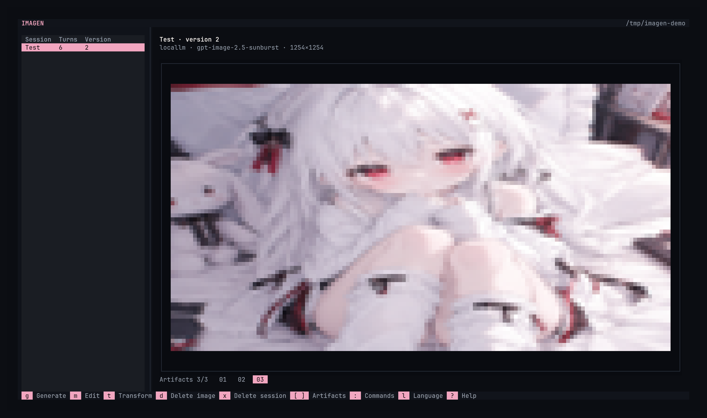
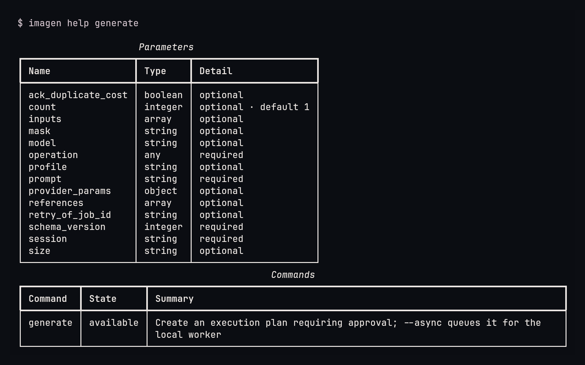
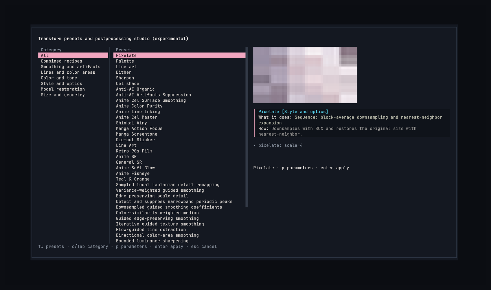
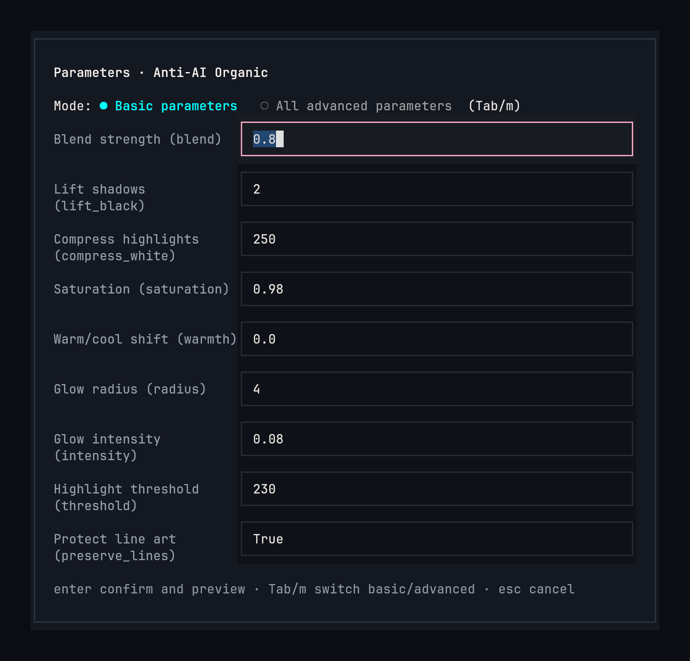
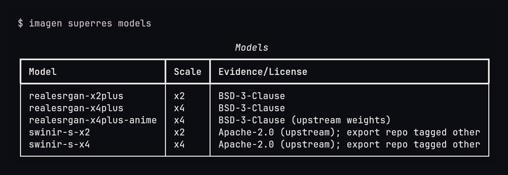
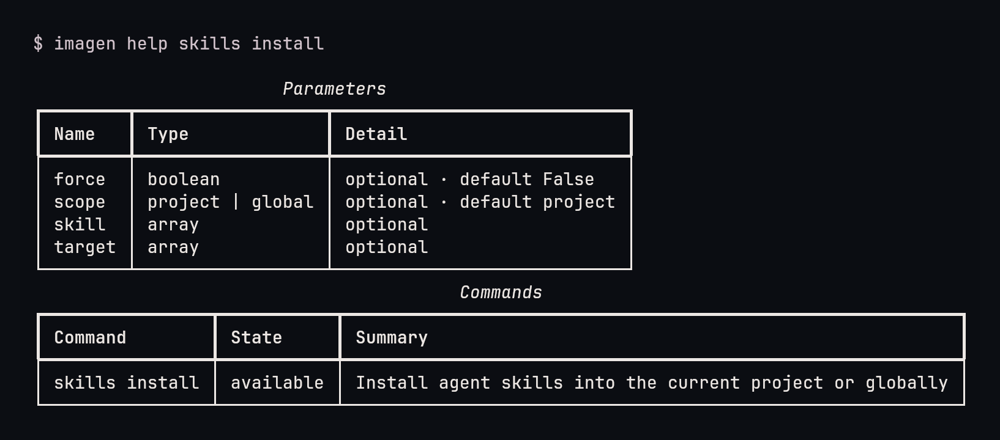

<p align="center">
  
</p>

<p align="center">
  <strong>A bridge between people, agents, and image generation models.</strong><br>
  <a href="README.zh-CN.md">中文</a>
</p>

Imagen connects people and coding agents to image generation models through a shared workspace. People can browse images, adjust parameters, review requests, and manage artifacts in the TUI. Agents can use the CLI, JSON output, and bundled skills to do the same work in the same sessions.

Configure your own image endpoint, create a session, and keep working from either interface. Plans, execution records, jobs, and image artifacts are stored locally, so a request made by an agent can be inspected and continued by a person, and the other way around.

## What it provides

- **One workspace, two interfaces.** The TUI and CLI read and write the same sessions, plans, jobs, and artifacts.
- **Your endpoint, your models.** Profiles support OpenAI-compatible Images endpoints and other adapters. Available models and parameters come from the configured endpoint.
- **Explicit execution.** A plan freezes the request for review. Approval and execution are separate steps; creating a plan never sends a generation request.
- **Local postprocessing.** Smoothing, line work, tone and color changes, periodic-frequency suppression, resizing, comparison, and contact sheets.
- **Batch and background work.** Local queues, independent child jobs, and an async worker.
- **Agent skills.** Bundled guides teach coding agents the CLI, approval rules, artifact handling, and cost and weight boundaries. They install into project or global directories for supported agents.
- **Optional local upscaling.** Model weights are selected and downloaded by the user, then checked against a pinned SHA-256 digest.
- **English and Chinese interface text.** English is the default; JSON keys, statuses, and command identifiers do not change with the language.

Processing always creates a new artifact. It never overwrites the input.

## How it fits together

```text
request ──► plan (review) ──► approve ──► execute ──► job + artifact
                                                        │
                                          postprocess ◄─┴─► compare / sheet
```

A turn records one creation attempt. A plan records the frozen request and digest. An artifact records the image and its provenance. Sessions group turns and artifacts. None of these require the TUI: the CLI produces the same records, and the TUI renders them.

## TUI and CLI at a glance

Most daily work is available in both interfaces. Keys below are TUI shortcuts.

| Task | TUI | CLI |
| --- | --- | --- |
| Browse sessions and images | session list, preview pane, `[` / `]` | `session list`, `session show`, `asset show` |
| Generate an image | `g` | `generate --input-json request.json` |
| Edit an image | `m` | `edit --input-json request.json` |
| Approve, execute, retry a plan | plan screen: `a`, `enter`, `r` | `plan approve`, `plan execute`, `plan retry` |
| Inspect jobs | not available | `job get`, `job wait`, `job fetch`, `job reconcile` |
| Local postprocessing | `t`, then `p` for parameters | `ops`, `transform`, `compare`, `sheet` |
| Open an image or folder | `o` / `O` | `asset open [--folder]` |
| Fork, export, delete a session | `f`, `e`, `x` | `session fork`, `session export`, `session delete` |
| Delete an image | `d` | `session remove-artifact`, `asset delete` |
| Providers and models | `v` | `profile ...`, `models ...`, `providers` |
| Cache audit and purge | `c` | `cache audit`, `cache purge` |
| Batch requests | not available | `batch submit`, `batch get`, `batch wait` |
| Background worker | not available | `worker start`, `worker status`, `worker recover` |
| Agent skills | not available | `skills list`, `skills install`, `skills uninstall` |
| Upscaling models | not available | `superres models`, `superres fetch`, `superres benchmark` |
| Command reference | `:` palette, `?` help | `imagen help`, `imagen schema` |
| Switch interface language | `l` | `--zh` / `--en` |

## Screenshots

### TUI

<p align="center"></p>

A saved session with image preview and artifact selection.

### CLI

<p align="center"></p>

Command help for `generate`.

## Install

Imagen requires Python 3.12 or later.

With [uv](https://docs.astral.sh/uv/), from a checkout:

```bash
uv sync --extra tui --extra postprocess
uv run imagen tui
```

Install into an existing virtual environment instead:

```bash
python -m pip install '.[tui,postprocess]'
imagen tui
```

`tui` installs Textual. `postprocess` installs the local image-processing dependencies. The base CLI, profiles, sessions, and provider access work without either extra.

Useful entry points:

```bash
imagen help                 # command index
imagen help generate        # parameters for one command
imagen schema generate      # JSON Schema, no network
imagen --agent help         # machine-oriented reference
```

## Quick start

1. Configure an endpoint and a credential reference.
2. Create a session.
3. Generate a plan, review it, approve it, execute it.
4. Inspect the job and artifact.
5. Optionally postprocess the artifact or compare it with another one.

```bash
export IMAGEN_API_KEY='your-api-key'

imagen profile set local \
  --provider openai \
  --family images \
  --base-url http://127.0.0.1:8000/v1 \
  --model-default your-image-model \
  --credential-ref env:IMAGEN_API_KEY

imagen models refresh --profile local
imagen session create sketchbook --output json
```

Then write `request.json` with the returned session ID:

```json
{
  "schema_version": 1,
  "operation": "generate",
  "session": "ses_REPLACE_WITH_RETURNED_ID",
  "profile": "local",
  "prompt": "A concise cel-shaded illustration with a solid background",
  "count": 1
}
```

```bash
imagen generate --input-json request.json --output json
imagen plan approve PLAN_ID --digest PLAN_DIGEST
imagen plan execute PLAN_ID
```

The same flow is available in the TUI: press `g`, fill the form, approve the plan with `a`, then execute with `enter`.

## Configure endpoints

Profiles keep an endpoint, model defaults, and a credential reference. The endpoint decides which models, operations, and parameters actually work.

```bash
imagen profile set local \
  --provider openai \
  --family images \
  --base-url http://127.0.0.1:8000/v1 \
  --model-default your-image-model \
  --credential-ref env:IMAGEN_API_KEY

imagen profile list
imagen profile show local
imagen profile update local --model-default another-model
```

Credential references:

- `env:NAME` reads an environment variable.
- `keyring:SERVICE` reads the operating-system keyring.
- `private:NAME` reads Imagen's private store in the workspace.

To import a key file into the private store without echoing it:

```bash
imagen profile secret --profile local --key-file ./key.txt
```

Do not put credentials in command arguments, request files, or session exports.

Models are declared per profile:

```bash
imagen models refresh --profile local   # fetch from the endpoint
imagen models add --profile local --id model-id
imagen models list --profile local
imagen models use local --id model-id   # set the profile default
```

In the TUI, press `v` to add or update profiles, refresh models, choose a default model, or enter a model ID manually.

## Generate and edit

Both operations follow the same lifecycle. `generate` creates an image; `edit` takes existing artifacts as inputs and may take a mask.

```bash
imagen generate --input-json request.json --output json
imagen edit --input-json edit-request.json --output json
```

The result is a plan with an ID and a digest. A plan does not contact the provider.

```bash
imagen plan show PLAN_ID
imagen plan approve PLAN_ID --digest PLAN_DIGEST
imagen plan execute PLAN_ID
```

Rules that matter:

- One execution sends at most one creation request.
- An approval is consumed by execution and cannot be reused.
- An unknown outcome is not retried automatically. Inspect the job first.
- An unknown cost is not recorded as zero.
- `plan execute` may incur a provider charge.
- A failed request can be retried with `plan retry`, which creates a new plan; it does not reuse the old approval.

Async execution uses the local worker:

```bash
imagen generate --input-json request.json --async
imagen worker start
imagen worker status
imagen worker recover
```

`--wait` waits for completion instead of returning as soon as the job is queued.

In the TUI, `g` generates and `m` edits. The plan screen supports approve (`a`), execute (`enter`), and retry (`r`). Approval and execution stay separate keys.

## Sessions, turns, and artifacts

A session groups turns and artifacts. A turn is one attempt. An artifact is a saved image with provenance.

```bash
imagen session create sketchbook --output json
imagen session list
imagen session show ses_...
imagen session resume ses_...
imagen session fork ses_... --from-turn trn_... --name variant
imagen session export ses_... --to backup.zip
imagen session import backup.zip
imagen session delete ses_... --yes
imagen session remove-artifact ses_... art_...
```

Artifacts can be inspected, opened, or deleted:

```bash
imagen asset show art_...
imagen asset open art_...
imagen asset open art_... --folder
imagen asset delete art_...
imagen session remove-artifact ses_... art_...
```

Orphaned managed files can be reclaimed:

```bash
imagen asset gc                 # dry-run, lists unreferenced artifacts
imagen asset gc --plan DIGEST --yes
imagen cache audit
imagen cache purge --plan DIGEST --yes
```

`asset delete` removes the artifact entity and its local file. `session remove-artifact` detaches the image from a session and, by default, reclaims the file when no other session references it. Soft-deleting a session frees its name for reuse; exports and imports remap identities, and exports do not include private credentials.

TUI equivalents: `n` creates a session, `f` forks the current turn, `e` exports, `x` deletes with typed confirmation, `d` removes the current image, `o` / `O` open the image or folder, and `c` audits and purges cache entries.

## Jobs

```bash
imagen job get job_...
imagen job wait job_... --timeout 600
imagen job fetch job_...
imagen job reconcile job_...
imagen job cancel job_...
```

- `job get` reads persisted facts.
- `job wait` observes local state within a bound; it does not poll the provider.
- `job fetch` saves inline images or safely downloads a result from a persisted response. It never regenerates.
- `job reconcile` checks local staging and restores images.
- `job cancel` stops local observation and requests termination for locally owned work where supported.

## Batch requests

`batch submit` validates every child request offline, approves and executes the batch, and creates one job per child.

```bash
imagen batch submit --input-json requests.json --concurrency 2
imagen batch get bat_...
imagen batch wait bat_... --timeout 600
```

`requests.json`:

```json
{
  "concurrency": 2,
  "requests": [
    {
      "schema_version": 1,
      "operation": "generate",
      "session": "ses_...",
      "profile": "local",
      "prompt": "first prompt",
      "size": "1024x1024"
    },
    {
      "schema_version": 1,
      "operation": "generate",
      "session": "ses_...",
      "profile": "local",
      "prompt": "second prompt",
      "size": "1024x1024"
    }
  ]
}
```

Children succeed or fail independently. A partial failure does not re-run the whole batch; plan a new request only for the children that definitively failed. If a child's outcome is unknown, inspect that job before deciding.

Batch submission sends real requests. Obtain explicit authorization for the whole batch first.

## Local postprocessing

Postprocessing is experimental. The CLI and TUI share one catalog, and every description states what the method does, what may change, and what may be lost.

<p align="center"></p>

<p align="center"></p>

Browse presets with a live preview, tune parameters, then apply. Results are saved as a new artifact.

```bash
imagen ops                                  # catalog
imagen ops --op guided_smooth               # one operator
imagen ops --preset 'Anti-AI Organic' --verbose  # recipe details
imagen transform ARTIFACT_ID --preset 'Pixel Art'
imagen transform ARTIFACT_ID --op 'guided_smooth:radius=4,epsilon=0.001,strength=0.5'
imagen compare art_a art_b
imagen sheet --artifacts art_a,art_b,art_c --columns 3
```

The catalog covers smoothing, line extraction, tone and color adjustment, periodic-frequency suppression, resizing, contact sheets, and image comparison. Some operations follow guided filtering, weighted least squares, or Local Laplacian methods; variants and approximations are labeled.

Limits:

- Smoothing may remove fine lines.
- Sharpening may amplify noise.
- Frequency suppression may delete intentional halftone patterns.
- Difference metrics do not replace visual inspection.
- Operations have not completed image-quality and preference evaluation across illustration, photography, and other domains.

TUI: `t` opens the transform studio; `p` edits parameters; `enter` applies. Applying saves a new artifact and leaves the source untouched.

## Optional upscaling

List local models and their licenses without downloading anything:



```bash
imagen superres models
```

After choosing a model and reviewing its source and weight license:

```bash
imagen superres fetch --model realesrgan-x4plus --accept
imagen superres benchmark --artifact ARTIFACT_ID --model realesrgan-x4plus
```

Downloaded weights are staged, checked against a pinned SHA-256 digest, and only then published into the weights directory. Failed or mismatched downloads leave no usable weight behind.

Imagen does not silently install the upscaling runtime or weights. A source-code license does not grant permission to use model weights. Reconstructed texture is not guaranteed to have existed in the original image.

## Agent skills

Imagen ships skills that teach coding agents when to use it, how to discover commands and schemas, how to follow the plan and approval lifecycle, how to handle unknown outcomes, and how to respect cost, credential, and weight-download boundaries.

```bash
imagen skills list
imagen skills install --target claude-code --target codex
imagen skills install --scope global --target claude-code
imagen skills uninstall --target codex
```



- Default scope is the current project; `--scope global` installs into user directories.
- `--target` may be repeated. `--target all` selects every target in the bundled compatibility table.
- Project-only agents are reported when global installation is requested.
- Installation writes a managed manifest (`.imagen-install.json`). Uninstall refuses unmanaged directories and symlinked paths. A locally modified managed skill needs `--force --yes`.
- When run in a terminal without `--target`, Imagen shows an interactive target selector.

The bundled skills are `imagen`, `imagen-assets`, and `imagen-batch`.

## Machine interface

`--agent` returns one JSON envelope; `--output json` does the same; `--output jsonl` emits events.

```json
{
  "schema_version": 1,
  "ok": false,
  "status": "approval_required",
  "data": {},
  "error": {
    "type": "approval_required",
    "message": "...",
    "retryable": false,
    "accepted_maybe": false,
    "next_actions": []
  }
}
```

JSON keys, status names, and identifiers are identical in English and Chinese. Only human-readable message text follows the interface language.

Exit codes:

| Code | Meaning |
| --- | --- |
| 0 | succeeded, accepted, approved, or planned |
| 2 | validation error or unsupported capability |
| 3 | authentication or permission error |
| 4 | not found |
| 5 | conflict |
| 6 | wait timeout, unknown outcome, or approval required |
| 7 | failed, save failed, or canceled |
| 8 | safety refusal |
| 9 | partial success |

`imagen schema COMMAND` returns the input, data, and event schemas. `imagen help --agent` returns the command index and the calling rules.

## Data and privacy

Sessions, plans, jobs, managed images, cache, and private credentials live in the workspace, by default under the user data directory. Use `--workspace PATH` to point commands at another workspace.

- Generation and editing send the prompt and required inputs to the endpoint you configured. Its retention, logging, and billing policies apply.
- Session exports exclude private credentials.
- Provider errors are reduced to safe categories; raw response bodies are never echoed into human output.
- Imagen does not retry unknown creation outcomes automatically.
- Imagen does not overwrite the source artifact during postprocessing.
- Imagen does not download model weights without explicit acceptance.

## Language

English is the default for help, human output, errors, and the TUI.

```bash
imagen --zh help                  # Chinese for one command
imagen --en help                  # force English
export IMAGEN_LANG=zh-CN          # current shell
imagen tui
```

`--zh` and `--en` are shortcuts; `--lang en|zh-CN` is the explicit form. A language flag takes precedence over `IMAGEN_LANG`, and only one language selector may be used per command. Inside the TUI, press `l` to switch immediately.

## Troubleshooting

**`approval_required`.** Review the plan, then run `plan approve` with its digest, followed by `plan execute`.

**`unknown` outcome.** Do not rerun the request. Use `job get` and, when a response was persisted, `job fetch` or `job reconcile`.

**The model is missing.** Run `models refresh --profile NAME`, or declare it with `models add --profile NAME --id MODEL`.

**The endpoint rejects edit or a parameter.** Capability depends on the provider and model. Check `providers`, the model catalog, and the endpoint documentation.

**The TUI preview is unavailable.** Image preview needs a truecolor terminal. The artifact still opens with `o` or `imagen asset open`.

**A skill cannot be uninstalled.** The directory is unmanaged, symlinked, or was modified after installation. Inspect the reported path first. Locally modified managed skills need `--force --yes`; unmanaged directories are never taken over.

**Upscaling fails before inference.** The runtime or weights are missing. Run `superres models`, then `superres fetch --model NAME --accept` after reviewing the license.

## Roadmap

- **Provider execution:** complete remote asynchronous job handling alongside the local queue and worker.
- **Image quality:** expand evaluation across illustration, photography, and other domains, including visual comparison and user preference. Postprocessing stays experimental until this is complete.
- **Platform support:** verify Windows on physical hardware and improve processing resource controls on Windows and macOS. Current size, buffer, and timeout checks are not a complete sandbox; Linux address-space limits do not cap RSS or GPU memory.
- **Language support:** add more interface languages. English is the default; Chinese is available through `--lang zh-CN` or `IMAGEN_LANG=zh-CN`.
- **Parity:** bring batch, worker, skills, and upscaling management into the TUI.

## Development

```bash
uv sync --group dev --extra tui --extra postprocess
uv run pytest
uv run ruff check .
uv run mypy src
```

The default test suite is offline. Live provider tests are marked `live` and require explicit authorization and credentials; they are not part of normal development.

Source layout:

| Path | Responsibility |
| --- | --- |
| `src/imagen_cli/cli` | entrypoint, registry, renderers, TUI |
| `src/imagen_cli/application` | planning, execution, artifacts, sessions, postprocessing, skills |
| `src/imagen_cli/domain` | contracts, identifiers, errors |
| `src/imagen_cli/providers` | endpoint adapters |
| `src/imagen_cli/execution` | queues, workers, configured execution |
| `src/imagen_cli/storage` | SQLite, artifacts, private state, workspace safety |

## Contributing

Small, focused changes are preferred. Add tests for behavior changes, keep provider requests behind the plan and approval boundary, and do not add live or paid provider tests without explicit authorization.

## License

Imagen source code is available under the [MIT License](LICENSE). Third-party dependencies, provider services, and model weights are covered by their own terms.

