# Imagen

<p align="center"></p>

**A terminal image workbench for people and coding agents: shared CLI/TUI sessions, reviewable generation plans, local post-processing.**

<!-- README-I18N:START -->
**English** · [中文](README.zh-CN.md)
<!-- README-I18N:END -->

Browse and work with images in the terminal, or let a coding agent use the same workspace through structured JSON commands. Both interfaces keep the same sessions, plans, jobs, and saved artifacts, so you can inspect and continue each other's work.

Connect an OpenAI-compatible Images endpoint or Gemini native `generateContent` for generation and editing. Requests are planned locally before you approve and execute them. Local transforms, model-based restoration, and upscaling save new artifacts without overwriting their inputs.

<p align="center">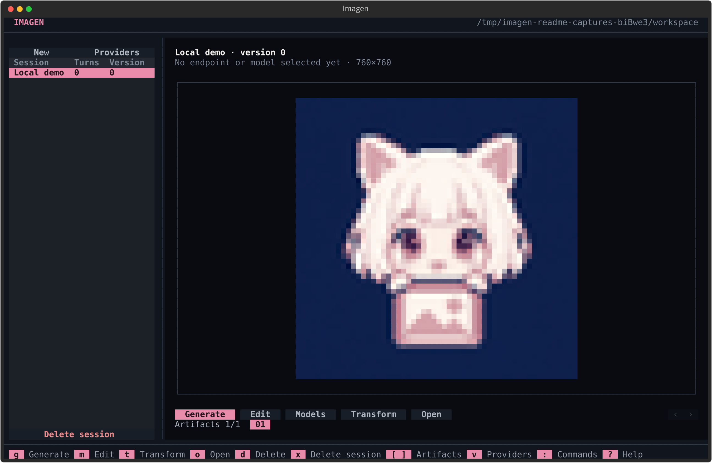</p>

*Local sample from the project artwork. Screenshots were exported from the actual CLI and headless TUI on 2026-10-28 (v0.1.10); no generation endpoint was called.*

> [!NOTE]
> Imagen runs the workflow on your machine. Generation and editing send prompts and required images to the endpoint you configure, and that endpoint may charge you. Local post-processing is experimental; model runtimes and weights are optional, separate downloads.

[Install](#install) · [Quick start](#quick-start) · [TUI and CLI](#tui-and-cli-at-a-glance) · [Local processing](#local-postprocessing) · [Agent interface](#machine-interface)

## What you can do

- **Move between people and agents.** Review in the TUI, automate with CLI/JSON, and resume the same sessions from either interface.
- **Review before generating.** Inspect a frozen request and its digest, then approve and execute it as separate steps. Unknown outcomes are not retried automatically.
- **Keep image work together.** Browse, fork, export, compare, and make contact sheets from saved artifacts and their provenance.
- **Process locally.** Use ordinary transforms or the separate model-processing page for restoration and upscaling. Large processing asks for budget confirmation first.
- **Remove watermarks on explicit terms.** Inspect first, keep the source, and confirm the pipeline license and any image upload before a run.
- **Automate with explicit boundaries.** Discover commands through JSON Schema, use bundled agent skills, and run authorized batches or local background jobs.

Help, errors, and TUI text support English and Simplified Chinese. JSON keys, status names, and command identifiers stay the same.

## What's new

The latest release adds a local watermark workbench and media batches:

- **Images:** `watermark identify`, `metadata`, `visible`, `erase`, `invisible`, `all`, and `classify`, with explicit license and memory-budget gates.
- **Video:** `watermark video identify`, `metadata`, `visible`, `all`, and `invisible`, including stream-copy metadata removal and stable visible-mark removal.
- **Batches:** `watermark batch` and `watermark video batch` process a directory into a new, empty output directory without touching the source.
- **Isolated extras:** `watermark setup --extras ...` installs only the dependency groups a task needs, such as `visible,video,diffusion`.

## Install

Requires **Python 3.12+**. For the TUI and local processing, install both extras:

```bash
uv tool install "imagen-cli[tui,postprocess]"
imagen --version
imagen tui
```

Alternatively, use pipx:

```bash
pipx install "imagen-cli[tui,postprocess]"
```

`tui` installs Textual; `postprocess` installs local processing dependencies. Omit the extras for the base CLI. Neither extra installs model runtimes or weights.

Check for updates, then explicitly install with the tool that owns this copy:

```bash
imagen update
imagen update --install
```

The installer recognizes `uv tool` and pipx. A checkout or plain pip installation gets a manual upgrade instruction instead of an automatic install.

<details>
<summary>Run from a source checkout</summary>

```bash
uv sync --extra tui --extra postprocess
uv run --no-sync imagen tui
```

Or install the checkout into an existing virtual environment:

```bash
python -m pip install '.[tui,postprocess]'
imagen tui
```

Keep any selected extras in later `uv sync` commands. Development checks are listed under [Development](#development).

</details>

## Quick start

### 1. Explore without an endpoint

```bash
imagen help
imagen ops
imagen schema generate
imagen tui
```

These commands do not send image-generation requests. In the TUI, use `?` for shortcuts, `v` for profiles, and `l` to switch language. Previewing saved images needs a truecolor terminal; files can also be opened in an external viewer.

### 2. Configure an endpoint and plan an image

The example below assumes an **already running** OpenAI-compatible Images endpoint at `http://127.0.0.1:8000/v1`. Replace the URL and default model with values your endpoint supports; Imagen does not start a server. Use [Gemini native](#gemini-native) for Google's protocol.

Supply your key through the environment, then save its reference rather than the secret itself:

```bash
imagen profile set local \
  --provider openai \
  --family images \
  --base-url http://127.0.0.1:8000/v1 \
  --model-default gpt-image-2.5-sunburst \
  --credential-ref env:IMAGEN_API_KEY

imagen session create sketchbook --agent
```

Set `IMAGEN_API_KEY` securely before execution. Write `request.json` using the returned session ID:

```json
{
  "schema_version": 1,
  "operation": "generate",
  "session": "ses_REPLACE_WITH_RETURNED_ID",
  "profile": "local",
  "prompt": "A concise cel-shaded illustration with a solid background",
  "count": 1
}
```

Create and inspect the plan; no creation request has been sent yet:

```bash
imagen generate --input-json request.json --agent
imagen plan show PLAN_ID
```

Replace `PLAN_ID` and `PLAN_DIGEST` with the returned values. **Only after reviewing the request and accepting any provider charges**, approve and execute:

```bash
imagen plan approve PLAN_ID --digest PLAN_DIGEST
imagen plan execute PLAN_ID
```

The TUI follows the same flow: `g` opens generation, `m` opens editing, `a` approves the plan, and `enter` executes it. `--async` and `batch submit` can queue or send requests directly; they require explicit authorization for that request or batch.

## How it fits together

```text
request ──► plan (review) ──► approve ──► execute ──► job + artifact
                                                        │
                                          postprocess ◄─┴─► compare / sheet
```

A **session** groups creation attempts (**turns**) and saved images (**artifacts**). A **plan** freezes the request and digest for review; a **job** records execution. These records live in the local workspace, independently of which interface you use.

## TUI and CLI at a glance

Dedicated pages cover everyday image work. `:` opens the command palette; CLI-only workflows can also be reached there where supported, rather than through their own page.

The workbench has Import and Save as buttons. More (or `F10`) opens the remaining actions, including cache cleanup, export, image deletion and help; narrower terminals move editing and processing buttons into this menu. In forms, Tab / Shift+Tab move between fields and Enter operates the focused control. Use the submit button or Ctrl+Enter to submit the whole form. Confirmations default to No.

| Task | TUI | CLI |
| --- | --- | --- |
| Browse sessions and images | session list, preview, `[` / `]` | `session list`, `session show`, `asset show` |
| Generate / edit | `g` / `m` | `generate`, `edit` |
| Approve / execute / retry a plan | plan page: `a`, `enter`, `r` | `plan approve`, `plan execute`, `plan retry` |
| Ordinary image processing | `t`; `p` edits parameters | `ops`, `transform`, `compare`, `sheet` |
| Model restoration / upscaling | `u`; `s` manages runtimes and weights | `superres run`, `superres models`, `superres install`, `superres fetch`, `superres benchmark`, `superres doctor` |
| Local matting / cutouts | transform page preset; `s` lists the model | `matting run`, `matting models`, `matting install`, `matting fetch`, `matting doctor`, `transform --preset '抠图贴纸 (Cutout Sticker)'` |
| Watermark inspect / remove | command palette; no dedicated page | `watermark identify`, `watermark metadata`, `watermark visible`, `watermark erase`, `watermark invisible`, `watermark all`, `watermark classify`, `watermark batch`, `watermark video ...`, `watermark status` |
| Remote GPU job | command palette; no dedicated page | `remote ...`, `watermark ... --remote NAME` |
| Open image / folder | `o` / `O` | `asset open [--folder]` |
| Import image / save a copy | `i` / `S` | `session import-image`, `asset save` |
| Fork / export / delete session | `f`, `e`, `x` | `session fork`, `session export`, `session delete` |
| Delete image | `d` | `session remove-artifact`, `asset delete` |
| Profiles and endpoint models | `v` | `profile ...`, `models ...`, `providers` |
| Cache audit / purge | `c` | `cache audit`, `cache purge` |
| Jobs / batches / worker / skills | command palette; no dedicated pages | `job ...`, `batch ...`, `worker ...`, `skills ...` |
| Help / language | `?`, `l` | `help`, `schema`, `--zh`, `--en`, `language` |

<details>
<summary>CLI help screenshot</summary>

<p align="center">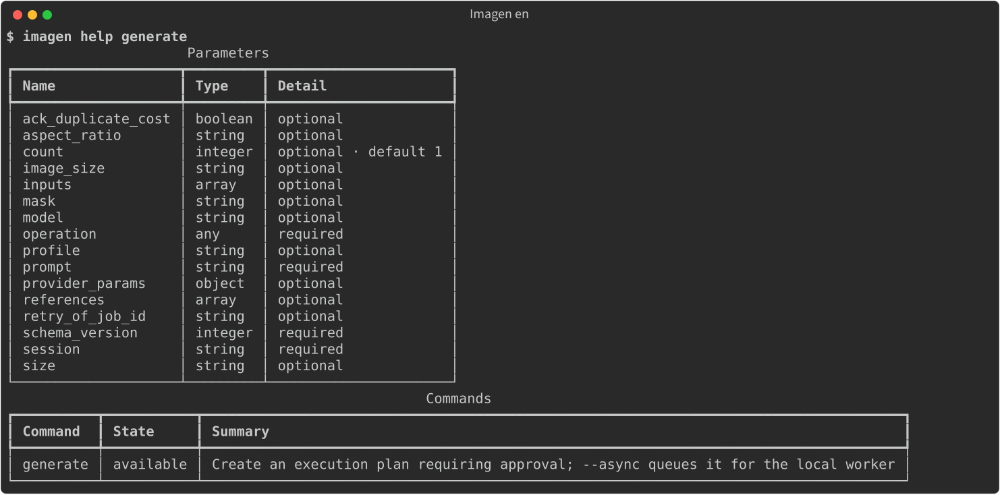</p>

Command help for `generate`. Run `help` and `schema` for the current parameter list.

</details>

## Configure endpoints

Profiles keep an endpoint, model defaults, and a credential reference. This build can execute **OpenAI Images** (`openai` / `images`) and **Gemini native** (`gemini` / `generate_content`). Other adapter definitions are not executable routes in this build and are refused during planning. The configured endpoint still determines model availability and accepted parameters.

```bash
imagen profile set local \
  --provider openai \
  --family images \
  --base-url http://127.0.0.1:8000/v1 \
  --model-default gpt-image-2.5-sunburst \
  --credential-ref env:IMAGEN_API_KEY

imagen profile list
imagen profile show local
imagen models use local --id another-model
```

Credential references:

- `env:NAME` reads an environment variable.
- `keyring:SERVICE` reads the operating-system keyring.
- `private:NAME` reads Imagen's private store in the workspace.

To import a key file into the private store without echoing it:

```bash
imagen profile secret local --key-file ./key.txt
```

Do not put credentials in command arguments, request files, or session exports.

Models are declared per profile:

```bash
imagen models refresh --profile local   # fetch from the endpoint
imagen models add --profile local --id model-id
imagen models list --profile local
imagen models use local --id model-id   # set the profile default
```

In the TUI, press `v` to manage profiles. Protocol, official endpoint, catalog path, and model are selection-first; choose **Custom / manual input** to reveal a text field. Saved custom values are preserved. Generation and edit forms let you choose a saved profile and its models.

<p align="center">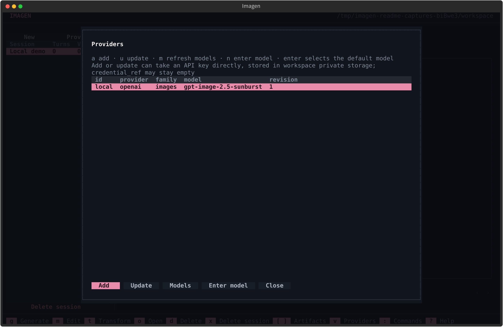</p>

### Image size and quality

Each route uses its own geometry fields:

| Route | Request fields | Example |
| --- | --- | --- |
| OpenAI Images | `size`; quality under `provider_params.quality` | `"size": "1536x1024"`, `"provider_params": {"quality": "high"}` |
| Gemini native | `aspect_ratio`, `image_size`; no `size` field | `"aspect_ratio": "16:9"`, `"image_size": "2K"` |

Put these fields in the creation JSON alongside `prompt` and `count`. Accepted sizes and quality values depend on the model. Gemini accepts one image per request and uppercase `K` tiers; unsupported parameters are rejected during planning. Use `imagen schema generate` for field descriptions and the endpoint's documentation for actual availability.

### Gemini native

Use `gemini` / `generate_content` for Gemini native requests, not the OpenAI Images protocol:

```bash
export GEMINI_API_KEY='your-api-key'
imagen profile set gemini \
  --provider gemini \
  --family generate_content \
  --base-url https://generativelanguage.googleapis.com/v1beta \
  --models-path /v1beta/models \
  --model-default gemini-3.1-flash-image \
  --credential-ref env:GEMINI_API_KEY

imagen models refresh gemini --send-credential
```

Custom HTTPS gateways are supported with a base URL ending in `/v1beta`; plain HTTP is limited to the supported loopback gateway addresses. The adapter sends `x-goog-api-key` and uses `models/{model}:generateContent` for generation and image editing. `nano-banana-2` is also accepted as a gateway model alias, including provider-prefixed IDs; actual availability depends on the gateway. Native continuation context is stored privately and can be restored for later edits. Gemini does not support masks in this adapter.

`--models-path` is independent of the generation protocol. New CLI/TUI profiles default to `/v1/models`; Google's native catalog needs the explicit `/v1beta/models` above. A gateway may instead use `/v1/models` even when generation uses `/v1beta`. The path replaces the base URL's path on the same origin: `https://gateway.example/v1beta` plus `/v1/models` becomes `https://gateway.example/v1/models`. Full external URLs, query strings, and fragments are not accepted. Old profiles without this setting retain `base_url + /models`.

Gemini catalog parsing prefers `models[].name`; only when `models` is absent does it accept `data[].id`. An empty native list is kept empty. No alternate-path request or generation retry is sent automatically. The catalog lists model IDs; confirm generation support with the endpoint or its documentation.

Use `"profile": "gemini"` in the same generation/edit JSON workflow below. Model discovery sends credentials only with `--send-credential`; the TUI fetch button explicitly sends the selected credential to the configured endpoint.

## Generate and edit

Both operations follow the same lifecycle. `generate` creates an image; `edit` takes existing artifacts as inputs and may take a mask.

```bash
imagen generate --input-json request.json --output json
imagen edit --input-json edit-request.json --output json
```

The result is a plan with an ID and a digest. A plan does not contact the provider.

```bash
imagen plan show PLAN_ID
imagen plan approve PLAN_ID --digest PLAN_DIGEST
imagen plan execute PLAN_ID
```

<p align="center">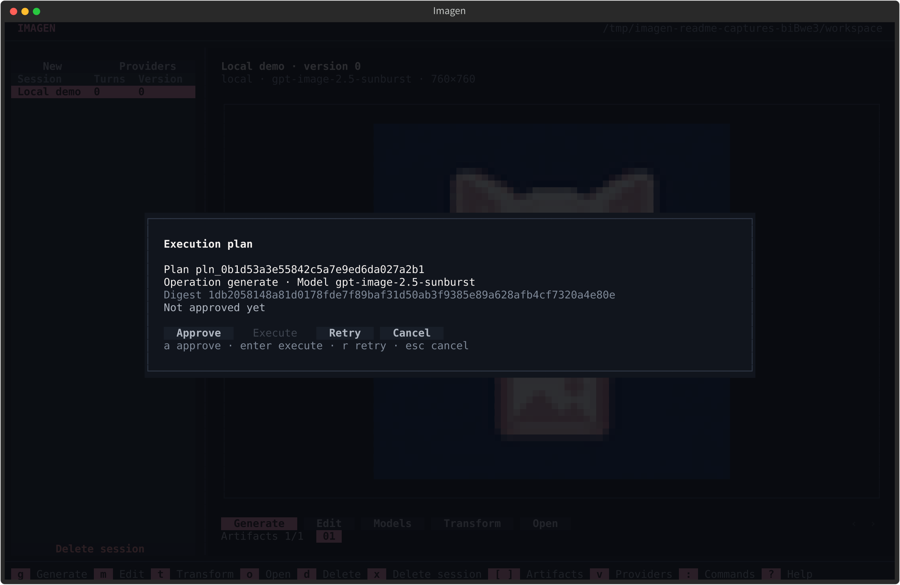</p>

This plan was created offline in a local workspace and left unapproved. `a` approves, `enter` executes, and `r` creates a new plan after a failure.

Rules that matter:

- One execution sends at most one creation request.
- An approval is consumed by execution and cannot be reused.
- An unknown outcome is not retried automatically. Inspect the job first.
- An unknown cost is not recorded as zero.
- `plan execute` may incur a provider charge.
- A failed request can be retried with `plan retry`, which creates a new plan; it does not reuse the old approval.

Async execution uses the local worker:

```bash
imagen generate --input-json request.json --async
imagen worker start
imagen worker status
imagen worker recover
```

`--wait` waits for completion instead of returning as soon as the job is queued.

In the TUI, `g` generates and `m` edits. The plan screen supports approve (`a`), execute (`enter`), and retry (`r`). Approval and execution stay separate keys.

## Sessions, turns, and artifacts

A session groups turns and artifacts. A turn is one attempt. An artifact is a saved image with provenance.

```bash
imagen session create sketchbook --output json
imagen session list
imagen session show ses_...
imagen session resume ses_...
imagen session fork ses_... --from-turn trn_... --name variant
imagen session export ses_... --to backup.zip
imagen session import backup.zip
imagen session import-image ses_... photo.png
imagen session delete ses_... --yes
imagen session remove-artifact ses_... art_...
```

<details>
<summary>CLI plan and session output</summary>

<p align="center">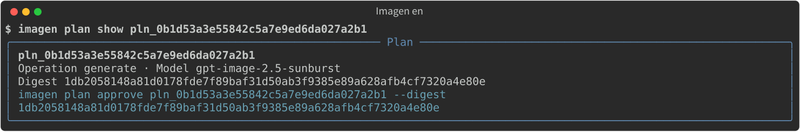</p>

<p align="center">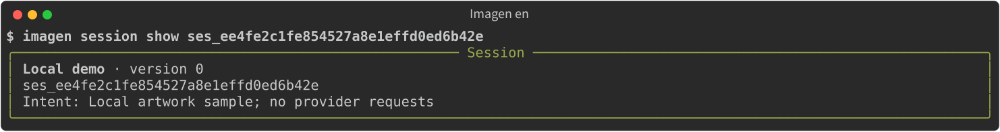</p>

</details>

Artifacts can be inspected, opened, or deleted:

```bash
imagen asset show art_...
imagen asset open art_...
imagen asset open art_... --folder
imagen asset save art_... ./copy.png
imagen asset delete art_...
imagen session remove-artifact ses_... art_...
```

Orphaned managed files can be reclaimed:

```bash
imagen asset gc                 # dry-run, lists unreferenced artifacts
imagen asset gc --plan DIGEST --yes
imagen cache audit
imagen cache purge --plan DIGEST --yes
```

`asset delete` removes the artifact entity and its local file. `session remove-artifact` detaches the image from a session and, by default, reclaims the file when no other session references it. `session import-image` copies an external image into a session as a new artifact without changing the source file; `asset save` writes a verified copy to a new path and never replaces an existing file. Soft-deleting a session frees its name for reuse; exports and imports remap identities, and exports do not include private credentials.

TUI equivalents: `n` creates a session, `f` forks the current turn, `e` exports, `x` deletes with Yes/No confirmation, `d` removes the current image, `o` / `O` open the image or folder, `i` imports an image and `S` saves a copy, and `c` opens cache cleanup. In the cache page, review the list and click Purge (or press `p`), then answer Yes/No. The app checks the confirmed list before deleting; if the list changes, it refreshes and asks you to confirm again. Cleanup results and any failed items remain visible. CLI cleanup still uses `--plan ... --yes`.

## Jobs

```bash
imagen job get job_...
imagen job wait job_... --timeout 600
imagen job fetch job_...
imagen job reconcile job_...
imagen job cancel job_...
```

- `job get` reads persisted facts.
- `job wait` observes local state within a bound; it does not poll the provider.
- `job fetch` saves inline images or safely downloads a result from a persisted response. It never regenerates.
- `job reconcile` checks local staging and restores images.
- `job cancel` stops local observation and requests termination for locally owned work where supported.

## Batch requests

`batch submit` validates every child request offline, approves and executes the batch, and creates one job per child.

```bash
imagen batch submit --input-json requests.json --concurrency 2
imagen batch get bat_...
imagen batch wait bat_... --timeout 600
```

`requests.json`:

```json
{
  "concurrency": 2,
  "requests": [
    {
      "schema_version": 1,
      "operation": "generate",
      "session": "ses_...",
      "profile": "local",
      "prompt": "first prompt",
      "size": "1024x1024"
    },
    {
      "schema_version": 1,
      "operation": "generate",
      "session": "ses_...",
      "profile": "local",
      "prompt": "second prompt",
      "size": "1024x1024"
    }
  ]
}
```

Children succeed or fail independently. A partial failure does not re-run the whole batch; plan a new request only for the children that definitively failed. If a child's outcome is unknown, inspect that job before deciding.

Batch submission sends real requests. Obtain explicit authorization for the whole batch first.

## Local postprocessing

Postprocessing is experimental. The CLI and TUI share one catalog, and every description states what the method does, what may change, and what may be lost.

<p align="center">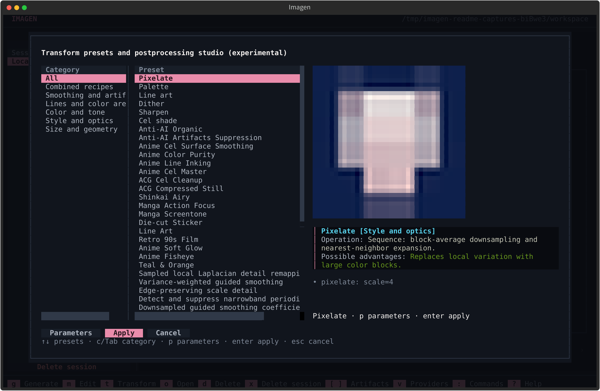</p>

<p align="center">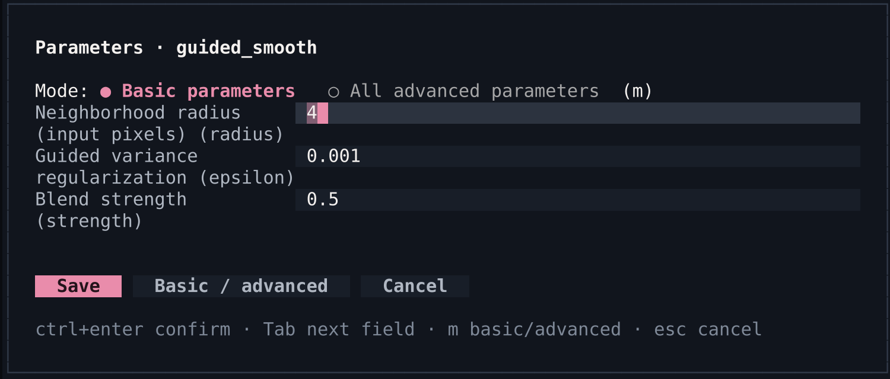</p>

The parameter screenshot is a cropped `guided_smooth` form. Browse presets with a live preview, tune parameters, then apply. Results are saved as a new artifact.

```bash
imagen ops                                  # catalog
imagen ops --op guided_smooth               # one operator
imagen ops --preset 'Anti-AI Organic' --verbose  # recipe details
imagen transform ARTIFACT_ID --preset 'Pixel Art'
imagen transform ARTIFACT_ID --op 'guided_smooth:radius=4,epsilon=0.001,strength=0.5'
imagen compare --first art_a --second art_b
imagen sheet --artifacts art_a,art_b,art_c --columns 3
```

The catalog covers smoothing, line extraction, tone and color adjustment, periodic-frequency suppression, resizing, contact sheets, and image comparison. Some operations follow guided filtering, weighted least squares, or Local Laplacian methods; variants and approximations are labeled.

What each transform may change:

- Smoothing can remove fine lines.
- Sharpening can amplify noise.
- Frequency suppression can delete intentional halftone patterns.
- Difference metrics report numbers; open the images to judge the result.

`Metadata Cleanup` (`--preset 'Metadata Cleanup'` or `--op strip_metadata`) applies EXIF orientation, re-encodes, and drops EXIF, XMP, IPTC, C2PA and PNG text chunks; the ICC color profile is kept. PNG-to-PNG output keeps the exact pixels. It does not remove pixel-level watermarks such as SynthID. The result is a new artifact and the source stays untouched.

TUI: `t` opens ordinary image processing; `p` edits parameters; `enter` applies. `u` opens the model workbench with actual model entries, ACG/restoration filters, original preview, expected output dimensions, and backend/tile/overlap/timeout controls. Choose foreground or background execution; download weights and confirm each run separately. `s` manages local weights and runtimes. Applying saves a new artifact and leaves the source untouched.

### Blocking, background jobs, and progress

`transform` and `superres run` wait for completion by default. `--wait` selects the same behavior explicitly. Start the worker before using `--async`; the command then returns a job ID while processing continues in the background.

```bash
imagen transform ARTIFACT_ID --op 'resize:scale=2' --wait
imagen worker start
imagen transform ARTIFACT_ID --op 'invert' --async
imagen superres run ARTIFACT_ID --model realesrgan-x4plus --accept --async
imagen job get JOB_ID
imagen job wait JOB_ID --timeout 900
imagen job cancel JOB_ID --scope local
```

Starting a worker also runs any queued generation requests. Review that queue before starting it. Local jobs keep their input, destination session, parameters, and result; `session show` lists both generation and processing outputs, including older results.

CLI progress appears on stderr in an interactive terminal. JSON returns one final result; JSONL includes progress events. The TUI shows the same processing stages: ordinary pipelines count completed steps, model inference counts completed tiles, and loading/encoding/saving use an activity indicator. Remote generation shows observable stages rather than an estimated percentage. Completed background outputs appear in the TUI automatically.

Local processing has two adjustable limits. The deadline adapts to the image size and the selected operators; set `IMAGEN_POSTPROCESS_TIMEOUT` (seconds, `0` disables it) or write `"postprocess_timeout_seconds"` in `config.json` to replace it, and `--timeout 0` disables the deadline for one run. The working-memory cap defaults to 2 GiB; set `IMAGEN_POSTPROCESS_MEMORY_MB` (MiB, `0` removes the cap and its confirmation prompt) or `"postprocess_memory_mb"` in the same file, which lives in the platform user config directory for `imagen-cli`. Above the cap, a run asks for confirmation instead of failing silently.

The processing timeout stops that computation. A `job wait` timeout only stops waiting; the job continues. Local cancellation stops queued or running processing without saving a partial image.

If processing exceeds the default pixel or working-buffer budget, Imagen reports the dimensions and memory risk and asks whether to continue; the default is cancel. Non-interactive CLI calls return `approval_required`. After explicitly accepting the risk, repeat the same request with `--budget-approval DIGEST` from that response. Approval is bound to the source contents and processing parameters; changing either requires a new confirmation. Memory or timeout can still fail the request after approval.

## Optional upscaling

<details>
<summary>Separate model-processing and local-model pages</summary>

<p align="center">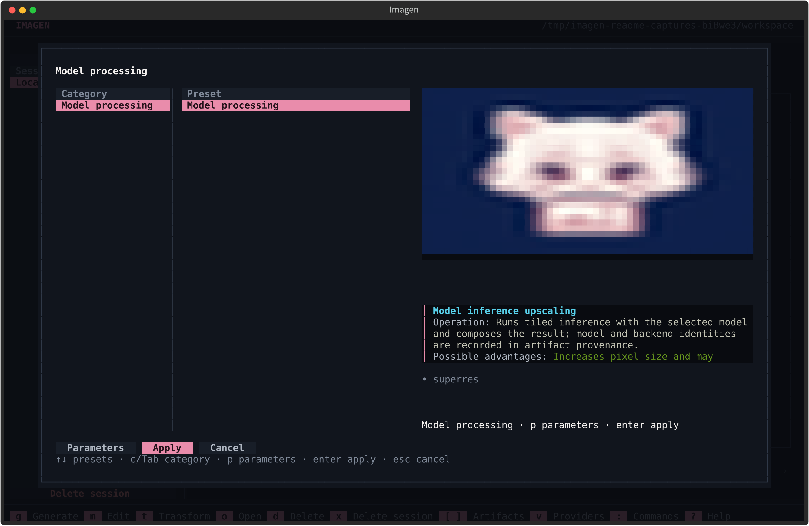</p>

`u` opens model processing. The preview shows a local sample image.

<p align="center">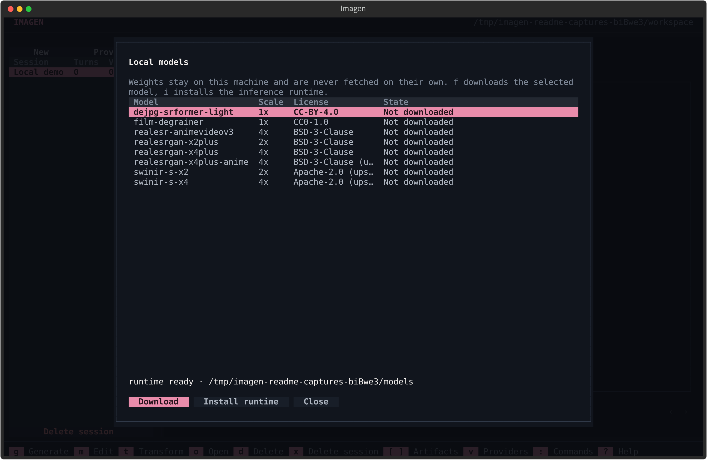</p>

`s` opens local model management. No weights were downloaded and no model was run for these captures. Some license labels are truncated in the table; use `imagen superres models` and the source license notes for full details.

</details>

List local models and their licenses without downloading anything:

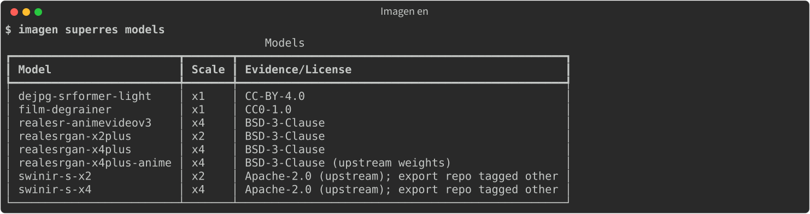

```bash
imagen superres models
```

After choosing a model and reviewing its source and weight license:

```bash
imagen superres fetch --model realesrgan-x4plus --accept
imagen superres benchmark --artifact ARTIFACT_ID --model realesrgan-x4plus
```

Install the optional runtime and the selected weights in one explicit step
(the command previews until `--accept` is given):

```bash
imagen superres install --model realesr-animevideov3
imagen superres install --model realesr-animevideov3 --accept
```

Install the runtime alone by leaving `--model` out (the first command only previews):

```bash
imagen superres install --backend cpu
imagen superres install --backend cpu --accept
```

The command targets the running ImagenCli virtual environment, never system Python.
Choose `cuda` or `openvino` explicitly for those distributions; conflicting ONNX runtime
packages are refused, not silently removed. GPU drivers are not installed. Restart
ImagenCli after installation. In a uv-managed source checkout, keep `--extra ai-onnx`
(or the selected backend extra) in subsequent `uv run`/`uv sync` commands.
The TUI command palette exposes the same backend and acceptance choices.
Before trusting a backend for a full image, `imagen superres doctor --backend cuda` runs one tile on a 32×32 sample and reports which provider actually ran. It proves the backend, not output quality.

## Local matting

Matting predicts an alpha channel locally and writes a new RGBA artifact; the source is never modified. It is what makes the alpha-only operators usable: `sticker_outline` and `background_blur` both refuse an ordinary RGB artifact.

```bash
imagen matting models
imagen matting install --model birefnet-lite --accept
imagen matting run ARTIFACT_ID
imagen transform ARTIFACT_ID --preset '抠图贴纸 (Cutout Sticker)'
```

`s` lists both model families in one table, with a Family column. The shipped default is `birefnet-lite`: an MIT-licensed BiRefNet_lite ONNX export with a 1024×1024 input. It holds soft edges on hair and fur for illustrations and photographs alike. Weights are never bundled; each entry is pinned to a SHA-256 and downloaded only with `--accept`.

### Cutouts come from three families

| Family | How | Runs on | Where the image goes | Cost |
|---|---|---|---|---|
| Local | `imagen matting run ART` | this machine (`--backend cpu/cuda/openvino`) | never leaves the machine | weights, downloaded once |
| Your own worker | `imagen matting run ART --remote NAME --accept-remote DIGEST` | the container you built (Salad, Modal, any endpoint) | your endpoint | you pay the compute |
| Vendor API | `imagen matting run ART --model owner/name --accept-api DIGEST` | Replicate | **api.replicate.com** | the vendor bills each run |

The three paths are mutually exclusive. `--remote` together with an `owner/name` model, or an explicit `--backend` with one, is a `validation_error` rather than a quiet choice of one path.

```bash
imagen matting models                                    # local and hosted, with a backend column
imagen matting run ARTIFACT_ID --model sprited/birefnet-toonout    # prints the digest, uploads nothing
imagen matting run ARTIFACT_ID --model sprited/birefnet-toonout --accept-api DIGEST
```

`sprited/birefnet-toonout` is the default hosted model: ToonOut, an MIT-licensed BiRefNet fine-tune for anime and line art. `sprited/birefnet` exposes the official variant set (this command always uses `variant=general`, `precision=fp32`, `output_format=cutout`), `men1scus/birefnet` is the most-used packaging, and `m-kunz/birefnet_portrait` is portrait-tuned. `sprited/birefnet-video` is listed but not implemented.

The token is read from `REPLICATE_API_TOKEN` (or `--replicate-key-ref`); it never reaches the config file, the artifact database or error output. Nothing is uploaded until `--accept-api` carries the digest of the exact request — source bytes, model and every parameter. A returned image that does not decode, or whose size disagrees with the source, is a failure and publishes nothing.

Non-commercial weights are deliberately absent from the catalog. Bria RMBG-2.0, for example, is CC BY-NC 4.0 and needs a separate commercial agreement, so it is not a drop-in default here.

`--tile 0` runs the whole image in one pass; a positive value splits large images, and `--overlap` keeps tile seams out of hair edges. `--feather` blurs the alpha and `--edge-shift` moves the apparent boundary; both default to `0`.

On a GPU with little memory the graph's fixed 1024x1024 input can fail to allocate
in fp32; a 4 GB card cannot. `--precision auto` runs fp32 first and, on an
allocation failure, derives a half-precision copy of the pinned weights, caches it
beside them, and retries once. `--precision fp16` goes straight to that path and
`--precision fp32` never falls back. Measured on an RTX 2050: fp32 fails on an
822 MB allocation, fp16 runs, and the alpha differs from the CPU fp32 reference by
at most 3/255 (mean 0.034/255). `imagen matting doctor` reports `precision_used`
and `fp16_cached`.

A matte is a prediction, not a guarantee. Thin strands, glass and semi-transparent material can be judged wrong, and an inaccurate matte leaves background colour on the edge.

Run upscaling or same-size restoration through the dedicated model-processing command:

```bash
imagen superres run ARTIFACT_ID --model realesrgan-x4plus
imagen superres fetch --model film-degrainer --accept
imagen superres run ARTIFACT_ID --model film-degrainer
imagen superres fetch --model dejpg-srformer-light --accept
imagen superres run ARTIFACT_ID --model dejpg-srformer-light
```

Existing `transform --op superres:...` scripts remain compatible. The separate entry uses the same execution, budget-confirmation, and artifact-storage path.

Film-Degrainer by tika is listed as CC0-1.0. DeJPG_SRFormer_light by Helaman is
CC BY 4.0: retain attribution and indicate changes. These are community ONNX
conversions by notaneimu, not official exports. Sources and license notes appear
in `imagen superres models`; neither model enlarges the image or guarantees improvement.

Anime and cel content has two upscaling choices:

```bash
imagen superres install --model realesrgan-x4plus-anime --accept
imagen superres install --model realesr-animevideov3 --accept
```

Both are BSD-3-Clause. `realesr-animevideov3` targets cel animation frames and
flat color areas; its pinned ONNX export records the upstream digest and
reference tensors. Deterministic ACG cleanup does not need a model download:

```bash
imagen transform ARTIFACT_ID --preset "ACG 赛璐璐轻修复 (ACG Cel Cleanup)"
imagen transform ARTIFACT_ID --op 'chroma_denoise:radius=2,strength=0.8'
imagen transform ARTIFACT_ID --op 'edge_antialias:radius=1,strength=0.6'
imagen transform ARTIFACT_ID --op 'cel_banding_reduce:strength=0.4'
```

Downloaded weights are staged, checked against a pinned SHA-256 digest, and only then published into the weights directory. Failed or mismatched downloads leave no usable weight behind.

Imagen installs the upscaling runtime and weights only when you run the install command and accept the license. Source and weight licenses are granted separately, so read the weight license before downloading. The model generates new detail when it reconstructs texture, and that detail may differ from the source image.

## Watermark removal

Watermark commands run in a separate, isolated `remove-ai-watermarks` environment and always write a new artifact; the source image is never modified. Start read-only:

```bash
imagen watermark status
imagen watermark identify ARTIFACT_ID
imagen watermark metadata ARTIFACT_ID
imagen watermark classify ARTIFACT_ID
```

`status` reports whether the isolated environment is ready; `identify` checks C2PA, EXIF, XMP, IPTC, TC260, and visible marks; `metadata` without `--remove` returns the same kind of report and publishes nothing. `classify` reads pixels only: it classifies a photograph or, with `--source`, the likely source pipeline. It is not provenance and does not detect SynthID.

To produce a new image:

```bash
imagen watermark metadata ARTIFACT_ID --remove
imagen watermark visible ARTIFACT_ID
imagen watermark erase ARTIFACT_ID --region 1640,1930,400,100
imagen watermark invisible ARTIFACT_ID --pipeline sdxl-zimage --accept-license
imagen watermark all ARTIFACT_ID --pipeline sdxl-zimage --accept-license
```

- `metadata --remove` strips AI metadata into a copy. It does not remove pixel-level watermarks.
- `visible` removes registered visible marks with a CPU backend (`cv2`, `migan`, or `lama`); `--mark NAME` targets one registered mark and `--sensitivity strict` keeps the high-precision detector gate.
- `erase` removes whatever lies inside each `--region x,y,width,height` box with the same CPU fill backends. Use it for marks the registry does not cover; the box must lie inside the image.
- `invisible` regenerates pixels through an image model to disrupt invisible watermarks such as SynthID-class marks. It needs a GPU, changes fine detail, and lowers fidelity. There is no local SynthID pixel detector, so Imagen cannot certify that a hidden mark is gone.
- `all` runs visible, invisible, and metadata removal in order. It needs the same license confirmation and GPU as `invisible`; when the invisible stage has no signal or no GPU it is skipped and the other stages still run.
- Each pipeline carries its own license (`qwen-zimage`, `qwen21-zimage`, `sdxl-zimage`, `chroma-zimage`); the default is `sdxl-zimage`, the smallest stack. Review it before `--accept-license`. A run estimated above the memory cap returns `approval_required` with a budget digest; repeat the identical command with `--budget-approval DIGEST`.
- `watermark setup --accept` creates the isolated environment with the `visible` extra. Add the extras you need, such as `--extras visible,qwen-zimage` for invisible work, `--extras visible,classify,source-classify` for classification, or `--extras visible,video,diffusion` for video, then restart Imagen. `watermark update --accept` builds and probes a new one, then switches; a failed update keeps the previous environment.

### Downscale, then upscale

```bash
imagen superres fetch --model realesrgan-x2plus --accept
imagen watermark resample ARTIFACT_ID --model realesrgan-x2plus
imagen watermark resample ARTIFACT_ID --backend cuda --factor 0.25
```

`resample` shrinks the image, then rebuilds it with a super-resolution model. That
rewrites pixel statistics, so it attacks pixel-level watermarks rather than a
verifiable signal: **Imagen makes no claim that the watermark is gone**, and the
report always carries `verified: false`.

It runs in-process and needs no `remove-ai-watermarks` environment, no diffusion
model, and no license confirmation beyond the weights you already fetched. Missing
weights are reported with the `imagen superres fetch --model NAME --accept` command
to run. `--factor` is downscale-only (`0 < factor <= 1`) and defaults to `1/scale`,
so the output keeps the source size up to rounding — an odd width or height loses a
pixel, which is why the report always lists `input_size`, `intermediate_size` and
`output_size` instead of leaving the change implicit. The result is always written
as PNG (a JPEG source changes container) and keeps the source's embedded ICC
profile. `--backend cuda` uses the GPU and reports the provider actually used.

### Video

Videos are imported like images with `session import-image`; Imagen stores the container bytes and reads width, height, and media type through `ffprobe`. Install `ffmpeg` and `ffprobe`, then add the `video` extra to the isolated environment.

```bash
imagen session import-image SESSION_ID clip.mp4
imagen watermark video identify ARTIFACT_ID
imagen watermark video metadata ARTIFACT_ID
imagen watermark video metadata ARTIFACT_ID --remove
imagen watermark video visible ARTIFACT_ID --mark auto
imagen watermark video all ARTIFACT_ID
imagen watermark video invisible ARTIFACT_ID --noise-std 0.15
```

- `video identify` reads container provenance and stable visible marks without writing anything.
- `video metadata --remove` remuxes with stream copy; it does not transcode video or audio.
- `video visible` scans the complete sequence and removes a mark only when it repeats at a stable position. When no mark matches, it writes no artifact.
- `video all` removes a stable visible mark and verified AI metadata, and always produces an output. `--include-invisible` adds the lossy VAE regeneration profile.
- `video invisible` regenerates pixels with one noise field shared across frames. It changes resolution, frame rate, and detail. There is no public local SynthID decoder, and the audio watermark is reported as unverified.
- Video work follows the same rule as images: the source artifact stays untouched; a new artifact is published.

### Directory batches

```bash
imagen watermark batch ./images --mode visible --to ./images_clean
imagen watermark batch ./images --mode all --accept-license --to ./images_clean
imagen watermark video batch ./videos --mode all --to ./videos_clean
```

Image batch modes are `visible`, `metadata`, `all`, and `invisible`; video batch modes are `all`, `visible`, and `metadata`. The output directory must be outside the source directory and empty, so an existing file is never replaced. A per-file failure is reported in `data.report.errors` and does not abort the run. Batches write plain files rather than managed artifacts, so they create no session/artifact records and no per-run budget digest; image `all` and `invisible` still require `--accept-license`.

### Remote GPU endpoints

Watermark work can run on a registered remote worker instead of the local GPU:

```bash
imagen remote add worker --endpoint https://worker.example --credential-ref env:WORKER_TOKEN
imagen remote status worker
imagen watermark invisible ARTIFACT_ID --remote worker --pipeline sdxl-zimage --accept-license
```

`remote add` probes `/v1/meta` and stores nothing if the probe fails. The first submission that uploads an image returns `approval_required` with a request digest; review the destination, then rerun the identical command with `--accept-remote DIGEST`. Credentials stay as `env:`, `keyring:`, or `private:` references and are never printed.

Inspect and recover recorded jobs with `remote jobs list`, `remote job get`, `remote job resume`, `remote job retry-interrupted`, and `remote job cancel`. `resume` re-reads a queued, running, or succeeded job; `retry-interrupted` reuses the same digest only for an interrupted job. An `unknown` outcome is recorded, not retried automatically. `--max-seconds` bounds polling for queue and shared-volume endpoints; a sync endpoint answers within its own short limit.

### Deploying the worker (Modal or Salad)

The repository ships one worker image with two deployment targets: `deploy/modal_app.py` for Modal and `deploy/salad/` for SaladCloud. These files are not packaged in the wheel, so deployment runs from a checkout; [deploy/README.md](deploy/README.md) covers the Modal secret, GPU sizing, and verification, and [deploy/salad/README.md](deploy/salad/README.md) covers queue mode.

```bash
modal deploy deploy/modal_app.py
imagen remote add modal --endpoint https://WORKSPACE--imagen-worker-web.modal.run --credential-ref env:IMAGEN_WORKER_TOKEN
imagen remote add salad --endpoint https://GROUP.salad.cloud --credential-ref env:IMAGEN_WORKER_TOKEN --gateway-credential-ref env:SALAD_API_KEY
```

Salad's Container Gateway requires the extra `--gateway-credential-ref env:SALAD_API_KEY`; the worker's own bearer token stays in `--credential-ref`. Publishing an image or creating cloud resources is outward-facing, so do it only after explicit authorization.

`imagen deploy` manages both control planes from the checkout. `deploy status` is read-only and reports readiness, the registered remote, and drift warnings; `deploy update` prints a plan and needs `--accept`. Renaming a Salad group is create-then-delete: the new group must answer `/readyz` before `--yes` allows removing the old one. Credentials accept `env:NAME` or `private:NAME`; `imagen deploy secret set --name NAME --key-file PATH` stores one privately and prints only its reference. Every Salad command needs `--salad-org` and `--salad-project`, either on the command line or as `deploy.salad.organization` and `deploy.salad.project` in `config.json`.

```bash
imagen deploy status --vendor salad --name imagen-worker-3090 --salad-key-ref env:SALAD_API_KEY --worker-token-ref env:IMAGEN_WORKER_TOKEN --salad-org ORGANIZATION --salad-project PROJECT
imagen deploy update --vendor salad --name imagen-worker-3090 --image ghcr.io/nekoccn/imagen-worker:TAG --salad-key-ref env:SALAD_API_KEY --worker-token-ref env:IMAGEN_WORKER_TOKEN --salad-org ORGANIZATION --salad-project PROJECT --accept
```

Build the two images explicitly, and push with a registry login when the package is private:

```bash
imagen deploy build --tag TAG --image ghcr.io/nekoccn/imagen-worker:TAG --accept
imagen deploy build --tag TAG --image ghcr.io/nekoccn/imagen-worker-queue:TAG --image-target salad-queue --base-image ghcr.io/nekoccn/imagen-worker:TAG --salad-queue-worker-url-ref env:SALAD_QUEUE_WORKER_URL --accept
imagen deploy build --tag TAG --image ghcr.io/PRIVATE/worker:TAG --push --registry-user-ref env:REGISTRY_USER --registry-password-ref private:registry-password --accept
```

`--image-target worker` builds the base worker; `--image-target salad-queue` builds the Salad queue image on top of it and needs the vendor Queue Worker URL, which is never baked in from a public URL. The registry password reaches `docker login` on stdin and is redacted from error output. `--matting-runtime gpu` installs the CUDA build plus the pip CUDA/cuDNN wheels instead of the CPU-only runtime.

A push also rewrites the manifest so every layer carries the OCI media type. Docker's legacy builder labels its own layers with the Docker type on top of an OCI base image, and Modal's unpacker rejects that mixture with `unsupported mediatype`; the rewrite changes only the label, not the layer bytes.

`deploy remove` deletes a Salad container group or stops the Modal app. It is the only command that destroys cloud state, so it needs both `--accept` and `--yes`; on Salad it reads the group first, so a mistyped name fails instead of silently reporting success:

```bash
imagen deploy remove --vendor salad --name imagen-worker-3090 --salad-key-ref env:SALAD_API_KEY --salad-org ORGANIZATION --salad-project PROJECT --accept --yes
imagen deploy remove --vendor modal --modal-token-id-ref env:MODAL_TOKEN_ID --modal-token-secret-ref env:MODAL_TOKEN_SECRET --accept --yes
```

Matting also runs on a registered worker. The image must have been built with matting enabled (`IMAGEN_MATTING=1`, the default); `/v1/meta` reports `capabilities.matte`, and a worker without it fails instead of falling back:

```bash
imagen matting run ARTIFACT_ID --remote worker --accept-remote DIGEST
```

## Agent skills

Imagen ships skills that teach coding agents when to use it, how to discover commands and schemas, how to follow the plan and approval lifecycle, how to handle unknown outcomes, and how to respect cost, credential, and weight-download boundaries.

```bash
imagen skills list
imagen skills install                     # asks which agents, in a terminal
imagen skills install --target universal  # the shared .agents/skills directory
imagen skills install --target claude-code --target codex
imagen skills install --scope global --target claude-code
imagen skills uninstall --target codex
```

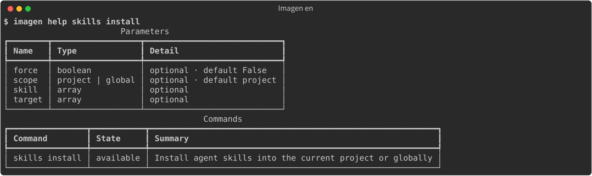

- Default scope is the current project; `--scope global` installs into user directories.
- Without `--target`, skills go to `universal` — the shared `.agents/skills` directory that most agents read. Add more agents with `--target`, which may be repeated; `--target all` selects every target in the bundled compatibility table.
- In a terminal without `--target`, Imagen opens a checklist: arrows move, space selects, `a` selects all, enter confirms, `q` cancels. The shared directory and any agent directory already present in the project start ticked. Without a terminal — or with `--no-interactive` — the command installs into the default target and never prompts.
- Project-only agents are reported when global installation is requested.
- Installation writes a managed manifest (`.imagen-install.json`). Uninstall refuses unmanaged directories and symlinked paths. A locally modified managed skill needs `--force --yes`.

The bundled skills are `imagen`, `imagen-assets`, and `imagen-batch`.

## Machine interface

`--agent` returns one JSON envelope; `--output json` does the same; `--output jsonl` emits events.

```json
{
  "schema_version": 1,
  "ok": false,
  "status": "approval_required",
  "data": {},
  "error": {
    "type": "approval_required",
    "message": "...",
    "retryable": false,
    "accepted_maybe": false,
    "next_actions": []
  }
}
```

JSON keys, status names, and identifiers are identical in English and Chinese. Only human-readable message text follows the interface language.

Exit codes:

| Code | Meaning |
| --- | --- |
| 0 | succeeded, accepted, approved, or planned |
| 2 | validation error or unsupported capability |
| 3 | authentication or permission error |
| 4 | not found |
| 5 | conflict |
| 6 | wait timeout, unknown outcome, or approval required |
| 7 | failed, save failed, or canceled |
| 8 | safety refusal |
| 9 | partial success |

`imagen schema COMMAND` returns the input, data, and event schemas. `imagen help --agent` returns the command index and the calling rules.

## Data and privacy

Sessions, plans, jobs, managed images, cache, and private credentials live in the workspace, by default under the user data directory. Use `--workspace PATH` to point commands at another workspace.

- Generation and editing send the prompt and required inputs to the endpoint you configured. Its retention, logging, and billing policies apply.
- Session exports exclude private credentials.
- Provider errors are reduced to safe categories; raw response bodies stay out of human output.
- Unknown creation outcomes wait for you to inspect the job; Imagen sends no automatic retry.
- Postprocessing writes a new artifact and leaves the source file untouched.
- Model weights download only after you accept the license.
- Elevation runs only after an interactive confirmation.

## Language

English is the default for help, human output, errors, and the TUI.

```bash
imagen --zh help                  # Chinese for one command
imagen --en help                  # force English
export IMAGEN_LANG=zh-CN          # current shell only
imagen language zh-CN             # save as the default
imagen language                   # show the saved default
imagen tui
```

`--zh` and `--en` are shortcuts; `--lang en|zh-CN` is the explicit form. A language flag takes precedence over `IMAGEN_LANG`, and only one language selector may be used per command.

`imagen language [en|zh-CN]` writes the default to the platform config directory (`config.json` under the Imagen user config path, readable only by you). The TUI's `l` key saves the same preference, so the choice survives restarts. Precedence is: command-line flag, then `IMAGEN_LANG`, then the saved default, then English.

## Troubleshooting

**`approval_required`.** For generation, review the plan, run `plan approve` with its digest, then `plan execute`. For oversized local processing, review the budget report and repeat the same request with `--budget-approval DIGEST`; that digest is its own confirmation, separate from a generation-plan approval.

**`unknown` outcome.** Do not rerun the request. Use `job get` and, when a response was persisted, `job fetch` or `job reconcile`.

**The model is missing.** Run `models refresh --profile NAME`, or declare it with `models add --profile NAME --id MODEL`.

**The endpoint rejects edit or a parameter.** Capability depends on the provider and model. Check `providers`, the model catalog, and the endpoint documentation.

**The TUI preview is unavailable.** Image preview needs a truecolor terminal. The artifact still opens with `o` or `imagen asset open`.

**A skill cannot be uninstalled.** The directory is unmanaged, symlinked, or was modified after installation. Inspect the reported path first. Locally modified managed skills need `--force --yes`; unmanaged directories are never taken over.

**Upscaling fails before inference.** The runtime or weights are missing. For the runtime, run `superres install --backend cpu --accept`. For weights, run `superres models`, then `superres fetch --model NAME --accept` after reviewing the license.

**Watermark commands report a missing environment.** Run `imagen watermark setup --accept` after reviewing the plan, then check `imagen watermark status`. Watermark work stays in an isolated environment and is never imported into the TUI or CLI process.

**Video commands report a missing ffmpeg or dependency.** Install `ffmpeg` and `ffprobe`, run `imagen watermark setup --extras visible,video,diffusion --accept`, then restart Imagen. `video invisible` and `--include-invisible` are lossy and cannot certify SynthID removal.

**A command fails with `permission_denied`.** Check the file permissions and required platform privileges before retrying. Where supported, an interactive terminal offers elevation for the same command, defaulting to No. Machine output modes, `--no-interactive`, and the TUI do not launch UAC; an agent must ask its human before any elevated action.

## Roadmap

- **Provider execution:** complete remote asynchronous job handling alongside the local queue and worker.
- **Image quality:** expand evaluation across illustration, photography, and other domains, including visual comparison and user preference. Postprocessing stays experimental until this is complete.
- **Platform support:** verify Windows on physical hardware and improve processing resource controls on Windows and macOS. Size, buffer, and timeout checks leave sandbox-level guarantees for later; Linux address-space limits cap virtual address space only, so RSS and GPU memory can still grow.
- **Language support:** add more interface languages. English is the default; Chinese is available through `--lang zh-CN` or `IMAGEN_LANG=zh-CN`.
- **Parity:** improve dedicated TUI workflows for batch, worker, and skills operations; the command palette and local-model management already exist.

## Development

```bash
uv sync --group dev --extra tui --extra postprocess
uv run pytest
uv run ruff check .
uv run mypy src
```

The default test suite is offline. Live provider tests are marked `live` and require explicit authorization and credentials; they are not part of normal development.

Source layout:

| Path | Responsibility |
| --- | --- |
| `src/imagen_cli/cli` | entrypoint, registry, renderers, TUI |
| `src/imagen_cli/application` | planning, execution, artifacts, sessions, postprocessing, skills |
| `src/imagen_cli/domain` | contracts, identifiers, errors |
| `src/imagen_cli/providers` | endpoint adapters |
| `src/imagen_cli/execution` | queues, workers, configured execution |
| `src/imagen_cli/storage` | SQLite, artifacts, private state, workspace safety |

## Contributing

For usage questions or reproducible bugs, [open an issue](https://github.com/NekoCCN/ImagenCli/issues) with the Imagen version, OS, command, and sanitized error. Do not attach API keys, raw provider responses, or private workspace exports. See [Releases](https://github.com/NekoCCN/ImagenCli/releases) for published changes.

Small, focused changes are preferred. Add tests for behavior changes, keep provider requests behind the plan and approval boundary, and do not add live or paid provider tests without explicit authorization.

## Acknowledgements

Imagen builds on open-source work. These are references to the projects whose behavior it relies on, not an endorsement or affiliation.

- [remove-ai-watermarks](https://github.com/wiltodelta/remove-ai-watermarks) by Victor Kuznetsov (wiltodelta), Apache-2.0: the watermark identification and removal engine. Imagen runs it in an isolated environment; its visible-mark registry, metadata stripping, diffusion pipelines, and video profiles are the upstream authors' work. Report upstream defects upstream.
- [FFmpeg](https://ffmpeg.org/) and FFprobe: video container inspection and remuxing or transcoding. They run as separate executables; the license of your FFmpeg build applies.
- [Textual](https://textual.textualize.io/): the terminal UI framework.
- [Pillow](https://python-pillow.org/): image decoding and encoding.
- [ONNX Runtime](https://onnxruntime.ai/), [OpenVINO](https://docs.openvino.ai/), and [PyTorch](https://pytorch.org/): optional local inference runtimes. Model weights keep their own licenses; check `imagen superres models` before downloading.

## License

Imagen source code is available under the [MIT License](LICENSE). Third-party dependencies, provider services, and model weights are covered by their own terms.

