# Imagen

<p align="center"></p>

**A terminal image workbench for people and coding agents: shared CLI/TUI sessions, reviewable generation plans, local post-processing.**

<!-- README-I18N:START -->
**English** · [中文](README.zh-CN.md)
<!-- README-I18N:END -->

Browse and work with images in the terminal, or let a coding agent use the same workspace through structured JSON commands. Both interfaces keep the same sessions, plans, jobs, and saved artifacts, so you can inspect and continue each other's work.

Connect an OpenAI-compatible Images endpoint or Gemini native `generateContent` for generation and editing. Requests are planned locally before you approve and execute them. Local transforms, model-based restoration, and upscaling save new artifacts without overwriting their inputs.

<p align="center">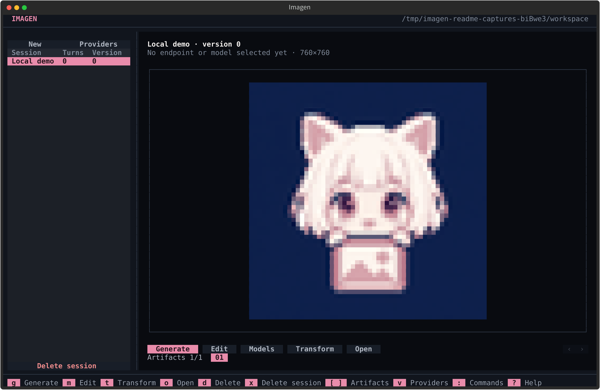</p>

*Local sample from the project artwork. Screenshots were exported from the actual CLI and headless TUI on 2026-10-28 (v0.1.10); no generation endpoint was called.*

> [!NOTE]
> Imagen runs the workflow on your machine. Generation and editing send prompts and required images to the endpoint you configure, and that endpoint may charge you. Local post-processing is experimental; model runtimes and weights are optional, separate downloads.

[Install](#install) · [Quick start](#quick-start) · [TUI and CLI](#tui-and-cli-at-a-glance) · [Local processing](#local-postprocessing) · [Agent interface](#machine-interface)

## What you can do

- **Move between people and agents.** Review in the TUI, automate with CLI/JSON, and resume the same sessions from either interface.
- **Review before generating.** Inspect a frozen request and its digest, then approve and execute it as separate steps. Unknown outcomes are not retried automatically.
- **Keep image work together.** Browse, fork, export, compare, and make contact sheets from saved artifacts and their provenance.
- **Process locally.** Use ordinary transforms or the separate model-processing page for restoration and upscaling. Large processing asks for budget confirmation first.
- **Automate with explicit boundaries.** Discover commands through JSON Schema, use bundled agent skills, and run authorized batches or local background jobs.

Help, errors, and TUI text support English and Simplified Chinese. JSON keys, status names, and command identifiers stay the same.

## Install

Requires **Python 3.12+**. For the TUI and local processing, install both extras:

```bash
uv tool install "imagen-cli[tui,postprocess]"
imagen --version
imagen tui
```

Alternatively, use pipx:

```bash
pipx install "imagen-cli[tui,postprocess]"
```

`tui` installs Textual; `postprocess` installs local processing dependencies. Omit the extras for the base CLI. Neither extra installs model runtimes or weights.

Check for updates, then explicitly install with the tool that owns this copy:

```bash
imagen update
imagen update --install
```

The installer recognizes `uv tool` and pipx. A checkout or plain pip installation gets a manual upgrade instruction instead of an automatic install.

<details>
<summary>Run from a source checkout</summary>

```bash
uv sync --extra tui --extra postprocess
uv run --no-sync imagen tui
```

Or install the checkout into an existing virtual environment:

```bash
python -m pip install '.[tui,postprocess]'
imagen tui
```

Keep any selected extras in later `uv sync` commands. Development checks are listed under [Development](#development).

</details>

## Quick start

### 1. Explore without an endpoint

```bash
imagen help
imagen ops
imagen schema generate
imagen tui
```

These commands do not send image-generation requests. In the TUI, use `?` for shortcuts, `v` for profiles, and `l` to switch language. Previewing saved images needs a truecolor terminal; files can also be opened in an external viewer.

### 2. Configure an endpoint and plan an image

The example below assumes an **already running** OpenAI-compatible Images endpoint at `http://127.0.0.1:8000/v1`. Replace the URL and default model with values your endpoint supports; Imagen does not start a server. Use [Gemini native](#gemini-native) for Google's protocol.

Supply your key through the environment, then save its reference rather than the secret itself:

```bash
imagen profile set local \
  --provider openai \
  --family images \
  --base-url http://127.0.0.1:8000/v1 \
  --model-default gpt-image-2.5-sunburst \
  --credential-ref env:IMAGEN_API_KEY

imagen session create sketchbook --agent
```

Set `IMAGEN_API_KEY` securely before execution. Write `request.json` using the returned session ID:

```json
{
  "schema_version": 1,
  "operation": "generate",
  "session": "ses_REPLACE_WITH_RETURNED_ID",
  "profile": "local",
  "prompt": "A concise cel-shaded illustration with a solid background",
  "count": 1
}
```

Create and inspect the plan; no creation request has been sent yet:

```bash
imagen generate --input-json request.json --agent
imagen plan show PLAN_ID
```

Replace `PLAN_ID` and `PLAN_DIGEST` with the returned values. **Only after reviewing the request and accepting any provider charges**, approve and execute:

```bash
imagen plan approve PLAN_ID --digest PLAN_DIGEST
imagen plan execute PLAN_ID
```

The TUI follows the same flow: `g` opens generation, `m` opens editing, `a` approves the plan, and `enter` executes it. `--async` and `batch submit` can queue or send requests directly; they require explicit authorization for that request or batch.

## How it fits together

```text
request ──► plan (review) ──► approve ──► execute ──► job + artifact
                                                        │
                                          postprocess ◄─┴─► compare / sheet
```

A **session** groups creation attempts (**turns**) and saved images (**artifacts**). A **plan** freezes the request and digest for review; a **job** records execution. These records live in the local workspace, independently of which interface you use.

## TUI and CLI at a glance

Dedicated pages cover everyday image work. `:` opens the command palette; CLI-only workflows can also be reached there where supported, rather than through their own page.

| Task | TUI | CLI |
| --- | --- | --- |
| Browse sessions and images | session list, preview, `[` / `]` | `session list`, `session show`, `asset show` |
| Generate / edit | `g` / `m` | `generate`, `edit` |
| Approve / execute / retry a plan | plan page: `a`, `enter`, `r` | `plan approve`, `plan execute`, `plan retry` |
| Ordinary image processing | `t`; `p` edits parameters | `ops`, `transform`, `compare`, `sheet` |
| Model restoration / upscaling | `u`; `s` manages runtimes and weights | `superres run`, `superres models`, `superres install`, `superres fetch`, `superres benchmark` |
| Open image / folder | `o` / `O` | `asset open [--folder]` |
| Fork / export / delete session | `f`, `e`, `x` | `session fork`, `session export`, `session delete` |
| Delete image | `d` | `session remove-artifact`, `asset delete` |
| Profiles and endpoint models | `v` | `profile ...`, `models ...`, `providers` |
| Cache audit / purge | `c` | `cache audit`, `cache purge` |
| Jobs / batches / worker / skills | command palette; no dedicated pages | `job ...`, `batch ...`, `worker ...`, `skills ...` |
| Help / language | `?`, `l` | `help`, `schema`, `--zh`, `--en`, `language` |

<details>
<summary>CLI help screenshot</summary>

<p align="center">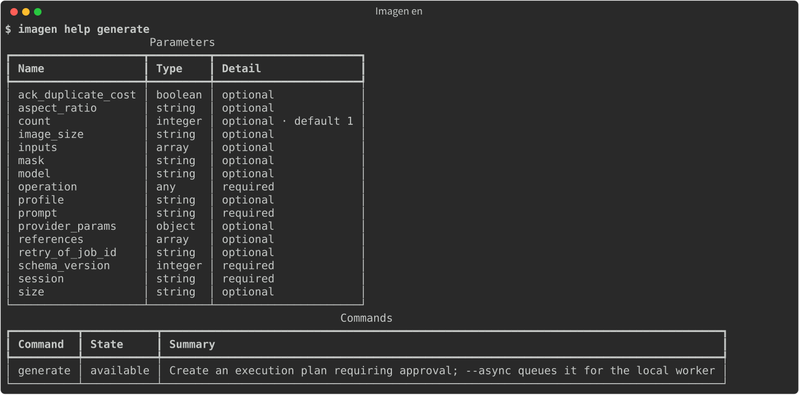</p>

Command help for `generate`. Run `help` and `schema` for the current parameter list.

</details>

## Configure endpoints

Profiles keep an endpoint, model defaults, and a credential reference. This build can execute **OpenAI Images** (`openai` / `images`) and **Gemini native** (`gemini` / `generate_content`). Other adapter definitions are not executable routes in this build and are refused during planning. The configured endpoint still determines model availability and accepted parameters.

```bash
imagen profile set local \
  --provider openai \
  --family images \
  --base-url http://127.0.0.1:8000/v1 \
  --model-default gpt-image-2.5-sunburst \
  --credential-ref env:IMAGEN_API_KEY

imagen profile list
imagen profile show local
imagen models use local --id another-model
```

Credential references:

- `env:NAME` reads an environment variable.
- `keyring:SERVICE` reads the operating-system keyring.
- `private:NAME` reads Imagen's private store in the workspace.

To import a key file into the private store without echoing it:

```bash
imagen profile secret local --key-file ./key.txt
```

Do not put credentials in command arguments, request files, or session exports.

Models are declared per profile:

```bash
imagen models refresh --profile local   # fetch from the endpoint
imagen models add --profile local --id model-id
imagen models list --profile local
imagen models use local --id model-id   # set the profile default
```

In the TUI, press `v` to manage profiles. Protocol, official endpoint, catalog path, and model are selection-first; choose **Custom / manual input** to reveal a text field. Saved custom values are preserved. Generation and edit forms let you choose a saved profile and its models.

<p align="center">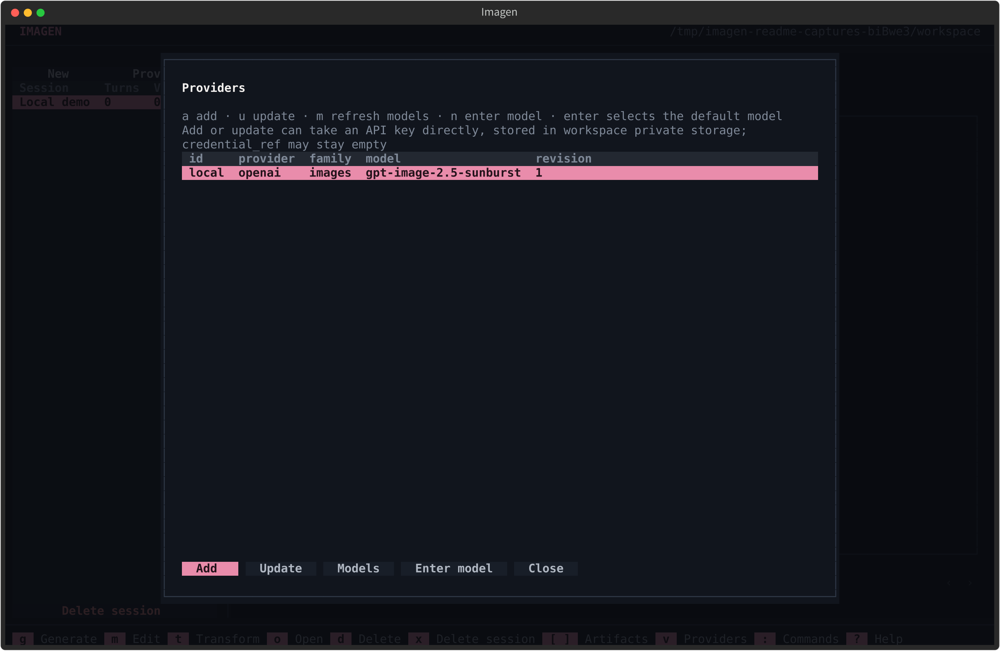</p>

### Image size and quality

Each route uses its own geometry fields:

| Route | Request fields | Example |
| --- | --- | --- |
| OpenAI Images | `size`; quality under `provider_params.quality` | `"size": "1536x1024"`, `"provider_params": {"quality": "high"}` |
| Gemini native | `aspect_ratio`, `image_size`; no `size` field | `"aspect_ratio": "16:9"`, `"image_size": "2K"` |

Put these fields in the creation JSON alongside `prompt` and `count`. Accepted sizes and quality values depend on the model. Gemini accepts one image per request and uppercase `K` tiers; unsupported parameters are rejected during planning. Use `imagen schema generate` for field descriptions and the endpoint's documentation for actual availability.

### Gemini native

Use `gemini` / `generate_content` for Gemini native requests, not the OpenAI Images protocol:

```bash
export GEMINI_API_KEY='your-api-key'
imagen profile set gemini \
  --provider gemini \
  --family generate_content \
  --base-url https://generativelanguage.googleapis.com/v1beta \
  --models-path /v1beta/models \
  --model-default gemini-3.1-flash-image \
  --credential-ref env:GEMINI_API_KEY

imagen models refresh gemini --send-credential
```

Custom HTTPS gateways are supported with a base URL ending in `/v1beta`; plain HTTP is limited to the supported loopback gateway addresses. The adapter sends `x-goog-api-key` and uses `models/{model}:generateContent` for generation and image editing. `nano-banana-2` is also accepted as a gateway model alias, including provider-prefixed IDs; actual availability depends on the gateway. Native continuation context is stored privately and can be restored for later edits. Gemini does not support masks in this adapter.

`--models-path` is independent of the generation protocol. New CLI/TUI profiles default to `/v1/models`; Google's native catalog needs the explicit `/v1beta/models` above. A gateway may instead use `/v1/models` even when generation uses `/v1beta`. The path replaces the base URL's path on the same origin: `https://gateway.example/v1beta` plus `/v1/models` becomes `https://gateway.example/v1/models`. Full external URLs, query strings, and fragments are not accepted. Old profiles without this setting retain `base_url + /models`.

Gemini catalog parsing prefers `models[].name`; only when `models` is absent does it accept `data[].id`. An empty native list is kept empty. No alternate-path request or generation retry is sent automatically. The catalog lists model IDs; confirm generation support with the endpoint or its documentation.

Use `"profile": "gemini"` in the same generation/edit JSON workflow below. Model discovery sends credentials only with `--send-credential`; the TUI fetch button explicitly sends the selected credential to the configured endpoint.

## Generate and edit

Both operations follow the same lifecycle. `generate` creates an image; `edit` takes existing artifacts as inputs and may take a mask.

```bash
imagen generate --input-json request.json --output json
imagen edit --input-json edit-request.json --output json
```

The result is a plan with an ID and a digest. A plan does not contact the provider.

```bash
imagen plan show PLAN_ID
imagen plan approve PLAN_ID --digest PLAN_DIGEST
imagen plan execute PLAN_ID
```

<p align="center">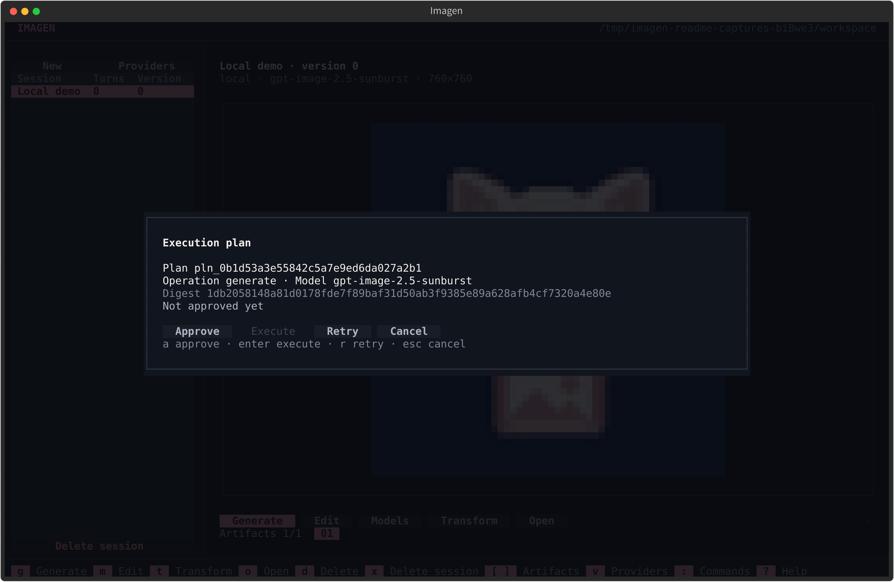</p>

This plan was created offline in a local workspace and left unapproved. `a` approves, `enter` executes, and `r` creates a new plan after a failure.

Rules that matter:

- One execution sends at most one creation request.
- An approval is consumed by execution and cannot be reused.
- An unknown outcome is not retried automatically. Inspect the job first.
- An unknown cost is not recorded as zero.
- `plan execute` may incur a provider charge.
- A failed request can be retried with `plan retry`, which creates a new plan; it does not reuse the old approval.

Async execution uses the local worker:

```bash
imagen generate --input-json request.json --async
imagen worker start
imagen worker status
imagen worker recover
```

`--wait` waits for completion instead of returning as soon as the job is queued.

In the TUI, `g` generates and `m` edits. The plan screen supports approve (`a`), execute (`enter`), and retry (`r`). Approval and execution stay separate keys.

## Sessions, turns, and artifacts

A session groups turns and artifacts. A turn is one attempt. An artifact is a saved image with provenance.

```bash
imagen session create sketchbook --output json
imagen session list
imagen session show ses_...
imagen session resume ses_...
imagen session fork ses_... --from-turn trn_... --name variant
imagen session export ses_... --to backup.zip
imagen session import backup.zip
imagen session delete ses_... --yes
imagen session remove-artifact ses_... art_...
```

<details>
<summary>CLI plan and session output</summary>

<p align="center">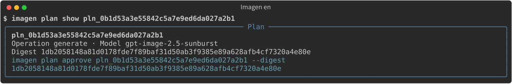</p>

<p align="center">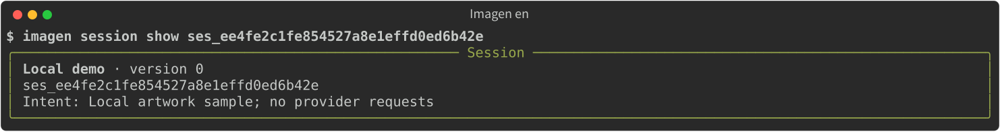</p>

</details>

Artifacts can be inspected, opened, or deleted:

```bash
imagen asset show art_...
imagen asset open art_...
imagen asset open art_... --folder
imagen asset delete art_...
imagen session remove-artifact ses_... art_...
```

Orphaned managed files can be reclaimed:

```bash
imagen asset gc                 # dry-run, lists unreferenced artifacts
imagen asset gc --plan DIGEST --yes
imagen cache audit
imagen cache purge --plan DIGEST --yes
```

`asset delete` removes the artifact entity and its local file. `session remove-artifact` detaches the image from a session and, by default, reclaims the file when no other session references it. Soft-deleting a session frees its name for reuse; exports and imports remap identities, and exports do not include private credentials.

TUI equivalents: `n` creates a session, `f` forks the current turn, `e` exports, `x` deletes with typed confirmation, `d` removes the current image, `o` / `O` open the image or folder, and `c` audits and purges cache entries.

## Jobs

```bash
imagen job get job_...
imagen job wait job_... --timeout 600
imagen job fetch job_...
imagen job reconcile job_...
imagen job cancel job_...
```

- `job get` reads persisted facts.
- `job wait` observes local state within a bound; it does not poll the provider.
- `job fetch` saves inline images or safely downloads a result from a persisted response. It never regenerates.
- `job reconcile` checks local staging and restores images.
- `job cancel` stops local observation and requests termination for locally owned work where supported.

## Batch requests

`batch submit` validates every child request offline, approves and executes the batch, and creates one job per child.

```bash
imagen batch submit --input-json requests.json --concurrency 2
imagen batch get bat_...
imagen batch wait bat_... --timeout 600
```

`requests.json`:

```json
{
  "concurrency": 2,
  "requests": [
    {
      "schema_version": 1,
      "operation": "generate",
      "session": "ses_...",
      "profile": "local",
      "prompt": "first prompt",
      "size": "1024x1024"
    },
    {
      "schema_version": 1,
      "operation": "generate",
      "session": "ses_...",
      "profile": "local",
      "prompt": "second prompt",
      "size": "1024x1024"
    }
  ]
}
```

Children succeed or fail independently. A partial failure does not re-run the whole batch; plan a new request only for the children that definitively failed. If a child's outcome is unknown, inspect that job before deciding.

Batch submission sends real requests. Obtain explicit authorization for the whole batch first.

## Local postprocessing

Postprocessing is experimental. The CLI and TUI share one catalog, and every description states what the method does, what may change, and what may be lost.

<p align="center">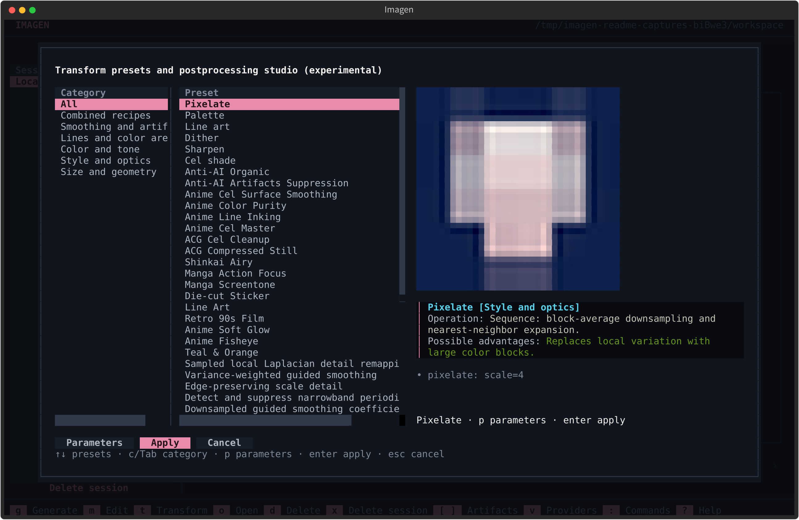</p>

<p align="center">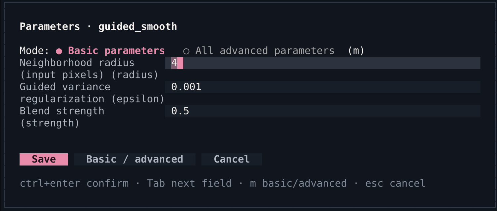</p>

The parameter screenshot is a cropped `guided_smooth` form. Browse presets with a live preview, tune parameters, then apply. Results are saved as a new artifact.

```bash
imagen ops                                  # catalog
imagen ops --op guided_smooth               # one operator
imagen ops --preset 'Anti-AI Organic' --verbose  # recipe details
imagen transform ARTIFACT_ID --preset 'Pixel Art'
imagen transform ARTIFACT_ID --op 'guided_smooth:radius=4,epsilon=0.001,strength=0.5'
imagen compare art_a art_b
imagen sheet --artifacts art_a,art_b,art_c --columns 3
```

The catalog covers smoothing, line extraction, tone and color adjustment, periodic-frequency suppression, resizing, contact sheets, and image comparison. Some operations follow guided filtering, weighted least squares, or Local Laplacian methods; variants and approximations are labeled.

What each transform may change:

- Smoothing can remove fine lines.
- Sharpening can amplify noise.
- Frequency suppression can delete intentional halftone patterns.
- Difference metrics report numbers; open the images to judge the result.

TUI: `t` opens ordinary image processing; `p` edits parameters; `enter` applies. Model processing has its own page under `u`; `s` manages local weights and runtimes. Applying saves a new artifact and leaves the source untouched.

If processing exceeds the default pixel or working-buffer budget, Imagen reports the dimensions and memory risk and asks whether to continue; the default is cancel. Non-interactive CLI calls return `approval_required`. After explicitly accepting the risk, repeat the same request with `--budget-approval DIGEST` from that response. Approval is bound to the source contents and processing parameters; changing either requires a new confirmation. Memory or timeout can still fail the request after approval.

## Optional upscaling

<details>
<summary>Separate model-processing and local-model pages</summary>

<p align="center">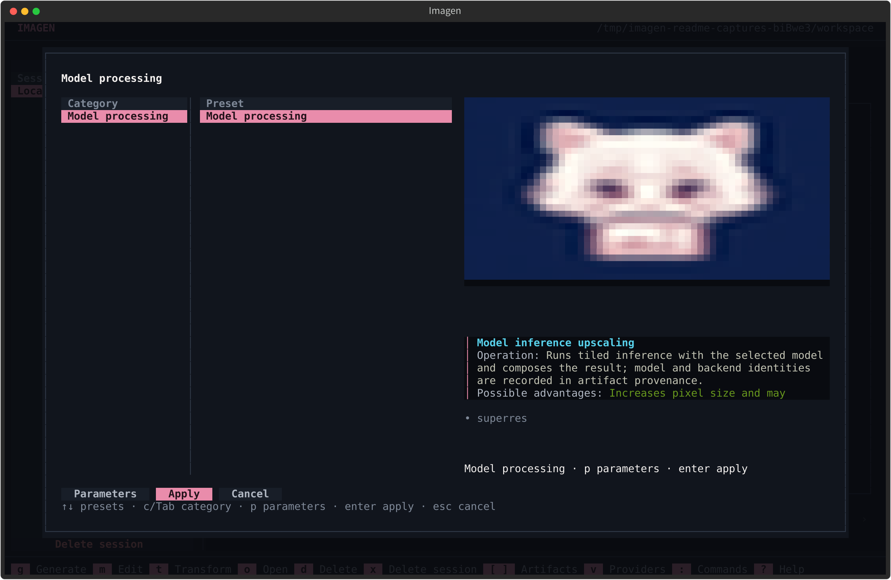</p>

`u` opens model processing. The preview shows a local sample image.

<p align="center">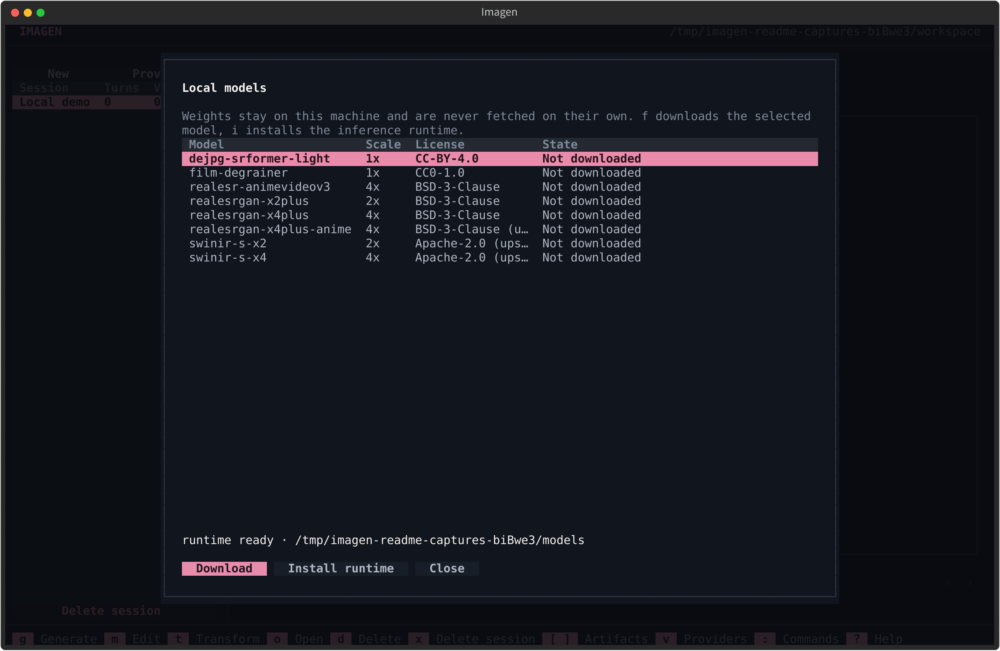</p>

`s` opens local model management. No weights were downloaded and no model was run for these captures. Some license labels are truncated in the table; use `imagen superres models` and the source license notes for full details.

</details>

List local models and their licenses without downloading anything:

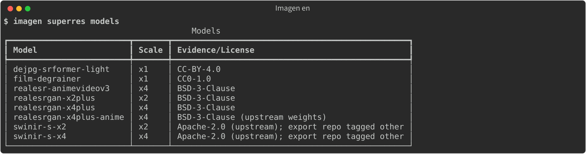

```bash
imagen superres models
```

After choosing a model and reviewing its source and weight license:

```bash
imagen superres fetch --model realesrgan-x4plus --accept
imagen superres benchmark --artifact ARTIFACT_ID --model realesrgan-x4plus
```

Install the optional runtime and the selected weights in one explicit step
(the command previews until `--accept` is given):

```bash
imagen superres install --model realesr-animevideov3
imagen superres install --model realesr-animevideov3 --accept
```

Install the runtime alone by leaving `--model` out (the first command only previews):

```bash
imagen superres install --backend cpu
imagen superres install --backend cpu --accept
```

The command targets the running ImagenCli virtual environment, never system Python.
Choose `cuda` or `openvino` explicitly for those distributions; conflicting ONNX runtime
packages are refused, not silently removed. GPU drivers are not installed. Restart
ImagenCli after installation. In a uv-managed source checkout, keep `--extra ai-onnx`
(or the selected backend extra) in subsequent `uv run`/`uv sync` commands.
The TUI command palette exposes the same backend and acceptance choices.

Run upscaling or same-size restoration through the dedicated model-processing command:

```bash
imagen superres run ARTIFACT_ID --model realesrgan-x4plus
imagen superres fetch --model film-degrainer --accept
imagen superres run ARTIFACT_ID --model film-degrainer
imagen superres fetch --model dejpg-srformer-light --accept
imagen superres run ARTIFACT_ID --model dejpg-srformer-light
```

Existing `transform --op superres:...` scripts remain compatible. The separate entry uses the same execution, budget-confirmation, and artifact-storage path.

Film-Degrainer by tika is listed as CC0-1.0. DeJPG_SRFormer_light by Helaman is
CC BY 4.0: retain attribution and indicate changes. These are community ONNX
conversions by notaneimu, not official exports. Sources and license notes appear
in `imagen superres models`; neither model enlarges the image or guarantees improvement.

Anime and cel content has two upscaling choices:

```bash
imagen superres install --model realesrgan-x4plus-anime --accept
imagen superres install --model realesr-animevideov3 --accept
```

Both are BSD-3-Clause. `realesr-animevideov3` targets cel animation frames and
flat color areas; its pinned ONNX export records the upstream digest and
reference tensors. Deterministic ACG cleanup does not need a model download:

```bash
imagen transform ARTIFACT_ID --preset "ACG 赛璐璐轻修复 (ACG Cel Cleanup)"
imagen transform ARTIFACT_ID --op 'chroma_denoise:radius=2,strength=0.8'
imagen transform ARTIFACT_ID --op 'edge_antialias:radius=1,strength=0.6'
imagen transform ARTIFACT_ID --op 'cel_banding_reduce:strength=0.4'
```

Downloaded weights are staged, checked against a pinned SHA-256 digest, and only then published into the weights directory. Failed or mismatched downloads leave no usable weight behind.

Imagen installs the upscaling runtime and weights only when you run the install command and accept the license. Source and weight licenses are granted separately, so read the weight license before downloading. The model generates new detail when it reconstructs texture, and that detail may differ from the source image.

## Agent skills

Imagen ships skills that teach coding agents when to use it, how to discover commands and schemas, how to follow the plan and approval lifecycle, how to handle unknown outcomes, and how to respect cost, credential, and weight-download boundaries.

```bash
imagen skills list
imagen skills install                     # asks which agents, in a terminal
imagen skills install --target universal  # the shared .agents/skills directory
imagen skills install --target claude-code --target codex
imagen skills install --scope global --target claude-code
imagen skills uninstall --target codex
```

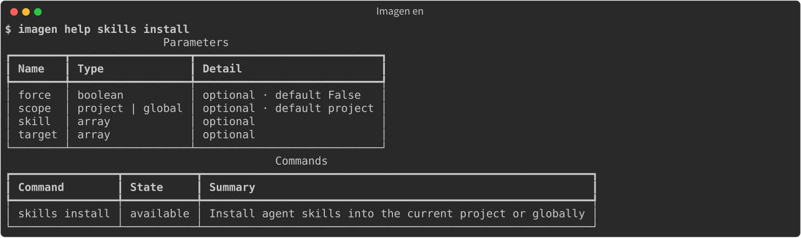

- Default scope is the current project; `--scope global` installs into user directories.
- Without `--target`, skills go to `universal` — the shared `.agents/skills` directory that most agents read. Add more agents with `--target`, which may be repeated; `--target all` selects every target in the bundled compatibility table.
- In a terminal without `--target`, Imagen opens a checklist: arrows move, space selects, `a` selects all, enter confirms, `q` cancels. The shared directory and any agent directory already present in the project start ticked. Without a terminal — or with `--no-interactive` — the command installs into the default target and never prompts.
- Project-only agents are reported when global installation is requested.
- Installation writes a managed manifest (`.imagen-install.json`). Uninstall refuses unmanaged directories and symlinked paths. A locally modified managed skill needs `--force --yes`.

The bundled skills are `imagen`, `imagen-assets`, and `imagen-batch`.

## Machine interface

`--agent` returns one JSON envelope; `--output json` does the same; `--output jsonl` emits events.

```json
{
  "schema_version": 1,
  "ok": false,
  "status": "approval_required",
  "data": {},
  "error": {
    "type": "approval_required",
    "message": "...",
    "retryable": false,
    "accepted_maybe": false,
    "next_actions": []
  }
}
```

JSON keys, status names, and identifiers are identical in English and Chinese. Only human-readable message text follows the interface language.

Exit codes:

| Code | Meaning |
| --- | --- |
| 0 | succeeded, accepted, approved, or planned |
| 2 | validation error or unsupported capability |
| 3 | authentication or permission error |
| 4 | not found |
| 5 | conflict |
| 6 | wait timeout, unknown outcome, or approval required |
| 7 | failed, save failed, or canceled |
| 8 | safety refusal |
| 9 | partial success |

`imagen schema COMMAND` returns the input, data, and event schemas. `imagen help --agent` returns the command index and the calling rules.

## Data and privacy

Sessions, plans, jobs, managed images, cache, and private credentials live in the workspace, by default under the user data directory. Use `--workspace PATH` to point commands at another workspace.

- Generation and editing send the prompt and required inputs to the endpoint you configured. Its retention, logging, and billing policies apply.
- Session exports exclude private credentials.
- Provider errors are reduced to safe categories; raw response bodies stay out of human output.
- Unknown creation outcomes wait for you to inspect the job; Imagen sends no automatic retry.
- Postprocessing writes a new artifact and leaves the source file untouched.
- Model weights download only after you accept the license.
- Elevation runs only after an interactive confirmation.

## Language

English is the default for help, human output, errors, and the TUI.

```bash
imagen --zh help                  # Chinese for one command
imagen --en help                  # force English
export IMAGEN_LANG=zh-CN          # current shell only
imagen language zh-CN             # save as the default
imagen language                   # show the saved default
imagen tui
```

`--zh` and `--en` are shortcuts; `--lang en|zh-CN` is the explicit form. A language flag takes precedence over `IMAGEN_LANG`, and only one language selector may be used per command.

`imagen language [en|zh-CN]` writes the default to the platform config directory (`config.json` under the Imagen user config path, readable only by you). The TUI's `l` key saves the same preference, so the choice survives restarts. Precedence is: command-line flag, then `IMAGEN_LANG`, then the saved default, then English.

## Troubleshooting

**`approval_required`.** For generation, review the plan, run `plan approve` with its digest, then `plan execute`. For oversized local processing, review the budget report and repeat the same request with `--budget-approval DIGEST`; that digest is its own confirmation, separate from a generation-plan approval.

**`unknown` outcome.** Do not rerun the request. Use `job get` and, when a response was persisted, `job fetch` or `job reconcile`.

**The model is missing.** Run `models refresh --profile NAME`, or declare it with `models add --profile NAME --id MODEL`.

**The endpoint rejects edit or a parameter.** Capability depends on the provider and model. Check `providers`, the model catalog, and the endpoint documentation.

**The TUI preview is unavailable.** Image preview needs a truecolor terminal. The artifact still opens with `o` or `imagen asset open`.

**A skill cannot be uninstalled.** The directory is unmanaged, symlinked, or was modified after installation. Inspect the reported path first. Locally modified managed skills need `--force --yes`; unmanaged directories are never taken over.

**Upscaling fails before inference.** The runtime or weights are missing. For the runtime, run `superres install --backend cpu --accept`. For weights, run `superres models`, then `superres fetch --model NAME --accept` after reviewing the license.

**A command fails with `permission_denied`.** Check the file permissions and required platform privileges before retrying. Where supported, an interactive terminal offers elevation for the same command, defaulting to No. Machine output modes, `--no-interactive`, and the TUI do not launch UAC; an agent must ask its human before any elevated action.

## Roadmap

- **Provider execution:** complete remote asynchronous job handling alongside the local queue and worker.
- **Image quality:** expand evaluation across illustration, photography, and other domains, including visual comparison and user preference. Postprocessing stays experimental until this is complete.
- **Platform support:** verify Windows on physical hardware and improve processing resource controls on Windows and macOS. Size, buffer, and timeout checks leave sandbox-level guarantees for later; Linux address-space limits cap virtual address space only, so RSS and GPU memory can still grow.
- **Language support:** add more interface languages. English is the default; Chinese is available through `--lang zh-CN` or `IMAGEN_LANG=zh-CN`.
- **Parity:** improve dedicated TUI workflows for batch, worker, and skills operations; the command palette and local-model management already exist.

## Development

```bash
uv sync --group dev --extra tui --extra postprocess
uv run pytest
uv run ruff check .
uv run mypy src
```

The default test suite is offline. Live provider tests are marked `live` and require explicit authorization and credentials; they are not part of normal development.

Source layout:

| Path | Responsibility |
| --- | --- |
| `src/imagen_cli/cli` | entrypoint, registry, renderers, TUI |
| `src/imagen_cli/application` | planning, execution, artifacts, sessions, postprocessing, skills |
| `src/imagen_cli/domain` | contracts, identifiers, errors |
| `src/imagen_cli/providers` | endpoint adapters |
| `src/imagen_cli/execution` | queues, workers, configured execution |
| `src/imagen_cli/storage` | SQLite, artifacts, private state, workspace safety |

## Contributing

For usage questions or reproducible bugs, [open an issue](https://github.com/NekoCCN/ImagenCli/issues) with the Imagen version, OS, command, and sanitized error. Do not attach API keys, raw provider responses, or private workspace exports. See [Releases](https://github.com/NekoCCN/ImagenCli/releases) for published changes.

Small, focused changes are preferred. Add tests for behavior changes, keep provider requests behind the plan and approval boundary, and do not add live or paid provider tests without explicit authorization.

## License

Imagen source code is available under the [MIT License](LICENSE). Third-party dependencies, provider services, and model weights are covered by their own terms.

