# Imagen

<p align="center"></p>

**面向人和 coding agent 的终端图像工作台：共享 CLI/TUI 会话，可审阅的生成计划，本地后处理。**

<!-- README-I18N:START -->
[English](README.md) · **中文**
<!-- README-I18N:END -->

在终端中浏览和处理图片，也可以让 coding agent 通过结构化 JSON 命令操作同一工作区。两种界面使用相同的会话、计划、任务和已保存产物，你和 agent 可以查看并接续彼此的工作。

连接 OpenAI-compatible Images 端点或 Gemini 原生 `generateContent`，完成生成与编辑。请求先在本地形成计划，再由你批准并执行。普通后处理、模型恢复和超分会另存新产物，不覆盖输入图片。

<p align="center">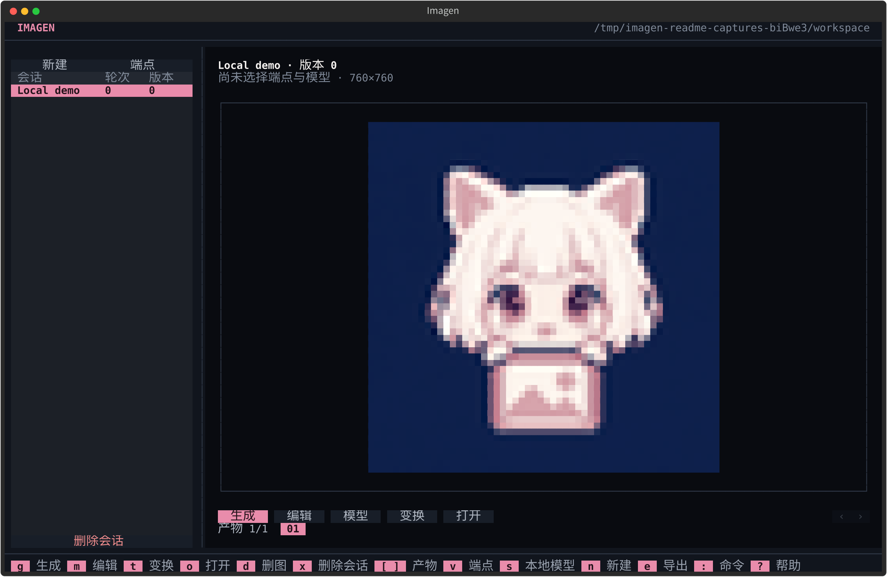</p>

*本地示例图来自项目插画。截图于 2026-10-28 从实际 CLI 与无头 TUI 导出（v0.1.10），未调用生成端点。*

> [!NOTE]
> Imagen 在本机完成图像工作流程。生成与编辑会把提示词和必要图片发送到你配置的端点，费用由该端点决定。本地后处理为 experimental；模型运行时与权重是独立的可选下载。

[安装](#安装) · [快速开始](#快速开始) · [TUI 与 CLI](#tui-与-cli-对照) · [本地处理](#本地后处理) · [Agent 接口](#机器接口)

## 可以做什么

- **人和 agent 接续工作**：在 TUI 中审阅，通过 CLI/JSON 自动化，从任一界面恢复同一会话。
- **生成前先审阅**：检查冻结请求与摘要，再分别批准和执行。结果未知时不会自动重试。
- **集中管理图像工作**：浏览、分支、导出、比较已保存产物，生成联系表，并保留来源信息。
- **本地处理图片**：普通变换与模型处理使用独立页面；模型页用于恢复和超分，大图超预算先询问。
- **按明确边界自动化**：用 JSON Schema 发现命令，使用随包 agent skills，执行已授权的批量请求或本地后台任务。

帮助、错误和 TUI 支持英文与简体中文；JSON 键、状态名和命令标识不随语言变化。

## 安装

需要 **Python 3.12+**。使用 TUI 和本地处理时，安装两个 extras：

```bash
uv tool install "imagen-cli[tui,postprocess]"
imagen --version
imagen tui
```

也可以使用 pipx：

```bash
pipx install "imagen-cli[tui,postprocess]"
```

`tui` 安装 Textual，`postprocess` 安装本地处理依赖。只用基础 CLI 可省略 extras；这两个 extra 均不会安装模型运行时或权重。

先检查更新，再明确调用管理当前安装的工具升级：

```bash
imagen update
imagen update --install
```

自动升级识别 `uv tool` 和 pipx。源码工作区或普通 pip 安装会得到手动升级指引，不自动安装。

<details>
<summary>从源码工作区运行</summary>

```bash
uv sync --extra tui --extra postprocess
uv run --no-sync imagen tui
```

也可在已有虚拟环境中安装当前源码：

```bash
python -m pip install '.[tui,postprocess]'
imagen tui
```

后续 `uv sync` 仍需保留所选 extras。开发检查见[开发](#开发)。

</details>

## 快速开始

### 1. 不配置端点，先查看功能

```bash
imagen help
imagen ops
imagen schema generate
imagen tui
```

这些命令不会发送生图请求。TUI 中 `?` 查看快捷键，`v` 管理 profile，`l` 切换语言。预览已保存图片需要 truecolor 终端，也可以用外部查看器打开文件。

### 2. 配置端点并规划一张图片

以下示例假设 `http://127.0.0.1:8000/v1` 上**已有运行中的** OpenAI-compatible Images 端点。请把 URL 和默认模型替换成端点实际支持的值；Imagen 不会启动服务器。Google 协议配置见 [Gemini 原生接口](#gemini-原生接口)。

通过环境变量提供密钥，profile 只保存引用，不保存这段命令中的密钥值：

```bash
imagen profile set local \
  --provider openai \
  --family images \
  --base-url http://127.0.0.1:8000/v1 \
  --model-default gpt-image-2.5-sunburst \
  --credential-ref env:IMAGEN_API_KEY

imagen session create sketchbook --agent
```

执行前安全设置 `IMAGEN_API_KEY`。把返回的会话 ID 写入 `request.json`：

```json
{
  "schema_version": 1,
  "operation": "generate",
  "session": "ses_REPLACE_WITH_RETURNED_ID",
  "profile": "local",
  "prompt": "A concise cel-shaded illustration with a solid background",
  "count": 1
}
```

创建并查看计划，此时尚未发送创建请求：

```bash
imagen generate --input-json request.json --agent
imagen plan show PLAN_ID
```

把 `PLAN_ID` 与 `PLAN_DIGEST` 替换为返回值。**审阅请求并接受可能的供应商费用后**，再批准和执行：

```bash
imagen plan approve PLAN_ID --digest PLAN_DIGEST
imagen plan execute PLAN_ID
```

TUI 使用相同流程：`g` 打开生成，`m` 打开编辑，`a` 批准计划，`enter` 执行。`--async` 与 `batch submit` 可以直接排队或发送请求，必须先获得对该请求或整批的明确授权。

## 工作方式

```text
request ──► plan (review) ──► approve ──► execute ──► job + artifact
                                                        │
                                          postprocess ◄─┴─► compare / sheet
```

**会话**（session）组织创建尝试（**turn**）与已保存图片（**artifact**）。**计划**（plan）冻结请求及摘要供审阅，**任务**（job）记录执行。这些记录保存在本地工作区，TUI 和 CLI 读取同一份记录。

## TUI 与 CLI 对照

独立页面覆盖日常图像工作。`:` 打开命令面板；没有独立页面的 CLI 工作流，也可在命令面板支持的范围内调用。

工作台提供导入、另存按钮。“更多”（或 `F10`）可打开其余操作，包括缓存清理、导出、删除图片和帮助；窄终端会把编辑、处理等按钮收进此菜单。表单中 Tab / Shift+Tab 切换字段，Enter 操作当前控件；点击提交按钮或按 Ctrl+Enter 才提交整页。确认框默认选择“否”。

| 任务 | TUI | CLI |
| --- | --- | --- |
| 浏览会话与图片 | 会话列表、预览、`[` / `]` | `session list`、`session show`、`asset show` |
| 生成／编辑 | `g` / `m` | `generate`、`edit` |
| 批准／执行／重试计划 | 计划页：`a`、`enter`、`r` | `plan approve`、`plan execute`、`plan retry` |
| 普通图像处理 | `t`；`p` 调参 | `ops`、`transform`、`compare`、`sheet` |
| 模型恢复／超分 | `u`；`s` 管理运行时与权重 | `superres run`、`superres models`、`superres install`、`superres fetch`、`superres benchmark` |
| 打开图片／目录 | `o` / `O` | `asset open [--folder]` |
| 导入图片／另存副本 | `i` / `S` | `session import-image`、`asset save` |
| 分支／导出／删除会话 | `f`、`e`、`x` | `session fork`、`session export`、`session delete` |
| 删除图片 | `d` | `session remove-artifact`、`asset delete` |
| Profile 与端点模型 | `v` | `profile ...`、`models ...`、`providers` |
| 缓存审计／回收 | `c` | `cache audit`、`cache purge` |
| 任务／批量／worker／skills | 命令面板；无独立页面 | `job ...`、`batch ...`、`worker ...`、`skills ...` |
| 帮助／语言 | `?`、`l` | `help`、`schema`、`--zh`、`--en`、`language` |

<details>
<summary>CLI 帮助截图</summary>

<p align="center">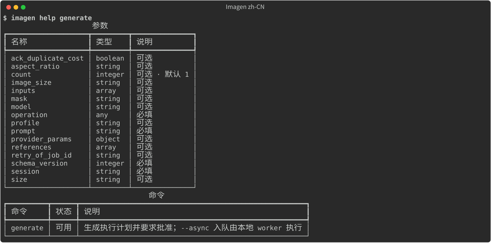</p>

`generate` 的命令帮助。当前参数以 `help`、`schema` 输出为准。

</details>

## 配置端点

Profile 保存端点、默认模型与凭据引用。当前版本可执行 **OpenAI Images**（`openai` / `images`）与 **Gemini 原生接口**（`gemini` / `generate_content`）；其他适配器定义尚未接入本版本的执行路线，规划阶段会拒绝。具体模型是否可用、哪些参数生效，仍由配置的端点决定。

```bash
imagen profile set local \
  --provider openai \
  --family images \
  --base-url http://127.0.0.1:8000/v1 \
  --model-default gpt-image-2.5-sunburst \
  --credential-ref env:IMAGEN_API_KEY

imagen profile list
imagen profile show local
imagen models use local --id another-model
```

凭据引用：

- `env:NAME` 读取环境变量。
- `keyring:SERVICE` 读取操作系统 keyring。
- `private:NAME` 读取工作区内的 Imagen 私有存储。

把密钥文件导入私有存储且不回显：

```bash
imagen profile secret local --key-file ./key.txt
```

不要把凭据写进命令参数、请求文件或会话导出。

模型按 profile 声明：

```bash
imagen models refresh --profile local   # 从端点拉取
imagen models add --profile local --id model-id
imagen models list --profile local
imagen models use local --id model-id   # 设为 profile 默认
```

TUI 中按 `v` 管理 profile。协议、官方端点、模型目录路径和模型均以选择为主，选择 **自定义 / 手动输入** 后才展开输入框；已有自定义值会保留。生成和编辑表单可以选择已保存的 profile 及其模型。

<p align="center">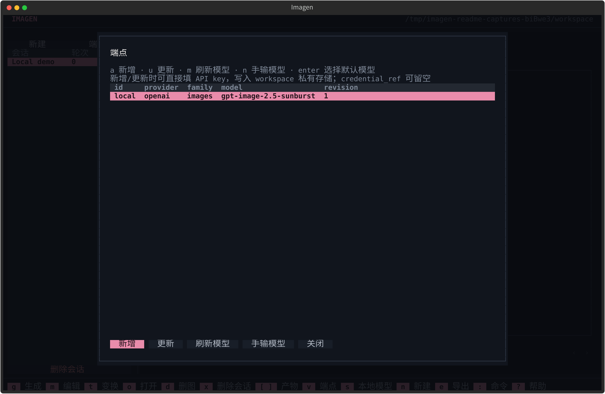</p>

### 图片尺寸与质量

各路线使用各自的几何字段：

| 路线 | 请求字段 | 示例 |
| --- | --- | --- |
| OpenAI Images | `size`；质量放在 `provider_params.quality` | `"size": "1536x1024"`、`"provider_params": {"quality": "high"}` |
| Gemini 原生接口 | `aspect_ratio`、`image_size`；不接受 `size` | `"aspect_ratio": "16:9"`、`"image_size": "2K"` |

在创建 JSON 中把这些字段与 `prompt`、`count` 并列填写。支持的尺寸和质量取值随模型变化；Gemini 每请求只接受一张图片，档位中的 `K` 必须大写。不支持的参数在规划阶段拒绝。字段说明见 `imagen schema generate`，实际可用性以端点文档为准。

### Gemini 原生接口

Gemini 原生请求使用 `gemini` / `generate_content`，不是 OpenAI Images 协议：

```bash
export GEMINI_API_KEY='your-api-key'
imagen profile set gemini \
  --provider gemini \
  --family generate_content \
  --base-url https://generativelanguage.googleapis.com/v1beta \
  --models-path /v1beta/models \
  --model-default gemini-3.1-flash-image \
  --credential-ref env:GEMINI_API_KEY

imagen models refresh gemini --send-credential
```

支持以 `/v1beta` 结尾的自定义 HTTPS 网关；明文 HTTP 仅限受支持的 loopback 网关地址。适配器通过 `x-goog-api-key` 认证，使用 `models/{model}:generateContent` 生图和编辑图片。也接受 `nano-banana-2` 网关模型别名及带供应商前缀的 ID，但实际可用性由网关决定。原生续接上下文保存在私有存储，可供后续编辑恢复；当前 Gemini 适配器不支持 mask。

`--models-path` 与生成协议独立。CLI/TUI 新建配置默认 `/v1/models`；Google 原生目录需显式指定上面的 `/v1beta/models`。网关即使使用 `/v1beta` 生成，也可能使用 `/v1/models` 查询目录。路径相对于同源根地址：`https://gateway.example/v1beta` 加 `/v1/models` 得到 `https://gateway.example/v1/models`，不是拼接到 `/v1beta` 后。禁止填写跨主机完整 URL、query 或 fragment。缺少此字段的旧配置保留原来的 `base_url + /models` 行为。

Gemini 目录优先解析 `models[].name`，只有不存在 `models` 字段时才兼容 `data[].id`；原生空列表不会被覆盖。Imagen 不会自动探测其他路径，也不会重试生成请求。目录只列出模型 ID，能否生图需向端点或其文档确认。

在下方相同的生成/编辑 JSON 流程中使用 `"profile": "gemini"` 即可。CLI 查询目录只有加 `--send-credential` 才发送凭据；TUI 的获取列表按钮会明确向配置端点发送所选凭据。

## 生成与编辑

两种操作走同一套流程。`generate` 创建图片；`edit` 读取已有产物作为输入，也可以带 mask。

```bash
imagen generate --input-json request.json --output json
imagen edit --input-json edit-request.json --output json
```

结果是带 ID 和摘要的计划。计划不会联系供应商。

```bash
imagen plan show PLAN_ID
imagen plan approve PLAN_ID --digest PLAN_DIGEST
imagen plan execute PLAN_ID
```

<p align="center">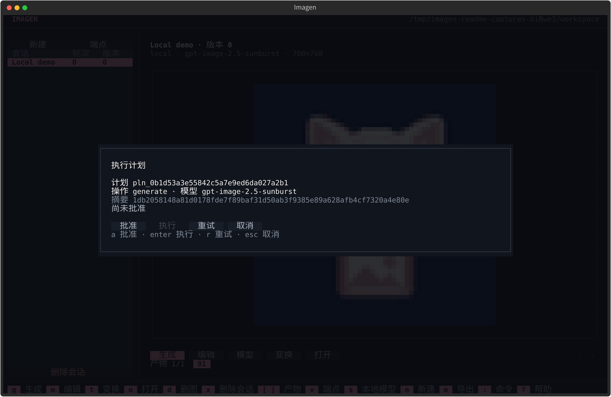</p>

这张计划在本地工作区离线生成，未批准也未执行。`a` 批准，`enter` 执行，失败后 `r` 重新生成计划。

需要遵守的规则：

- 一次执行最多发送一次创建请求。
- 批准会在执行时消耗，不能重复使用。
- 结果未知时不会自动重试，先核对任务。
- 费用未知时不会记为零。
- `plan execute` 可能产生供应商费用。
- 失败的请求可以用 `plan retry` 重建；它生成新计划，不会复用旧批准。

异步执行使用本地 worker：

```bash
imagen generate --input-json request.json --async
imagen worker start
imagen worker status
imagen worker recover
```

`--wait` 会等待完成，而不是入队后立即返回。

TUI 中 `g` 生成、`m` 编辑。计划页支持批准（`a`）、执行（`enter`）和重试（`r`），批准与执行始终是两个按键。

## 会话、轮次与产物

会话组织 turn 与产物。一个 turn 是一次尝试；产物是带来源信息的已保存图片。

```bash
imagen session create sketchbook --output json
imagen session list
imagen session show ses_...
imagen session resume ses_...
imagen session fork ses_... --from-turn trn_... --name variant
imagen session export ses_... --to backup.zip
imagen session import backup.zip
imagen session import-image ses_... photo.png
imagen session delete ses_... --yes
imagen session remove-artifact ses_... art_...
```

<details>
<summary>CLI 计划与会话输出</summary>

<p align="center">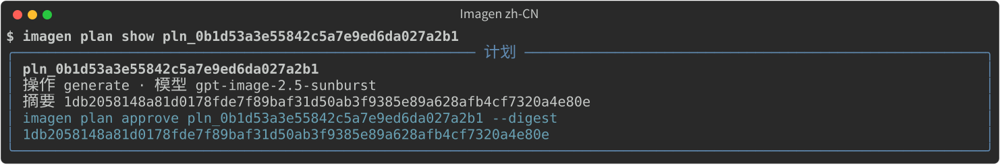</p>

<p align="center">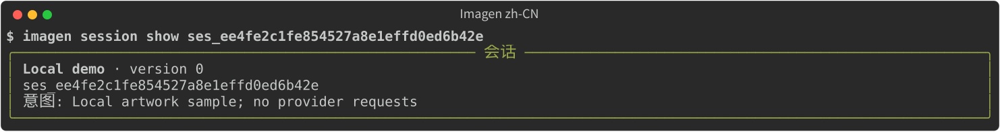</p>

</details>

产物可以查看、打开或删除：

```bash
imagen asset show art_...
imagen asset open art_...
imagen asset open art_... --folder
imagen asset save art_... ./copy.png
imagen asset delete art_...
imagen session remove-artifact ses_... art_...
```

无人引用的受管文件可以回收：

```bash
imagen asset gc                 # dry-run，列出未引用产物
imagen asset gc --plan DIGEST --yes
imagen cache audit
imagen cache purge --plan DIGEST --yes
```

`asset delete` 删除产物实体及本地文件；`session remove-artifact` 从会话移除图片，并在没有其他会话引用时默认回收文件。`session import-image` 把外部图片复制进会话成为新产物，不修改原文件；`asset save` 把经过校验的副本另存到新路径，不覆盖已有文件。逻辑删除会话会释放名称以便复用；导出与导入会重映射标识，导出不包含私有凭据。

TUI 对应操作：`n` 新建会话，`f` 从当前轮次分支，`e` 导出，`x` 通过 Yes/No 确认删除，`d` 删除当前图片，`o` / `O` 打开图片或目录，`i` 导入图片、`S` 另存副本，`c` 打开缓存清理。缓存页查看清单后点击“清理”（或按 `p`），再回答是／否。应用在删除前校验已确认的清单；清单变化就刷新并要求重新确认。清理结果和失败项留在页面上。CLI 清理仍使用 `--plan ... --yes`。

## 任务

```bash
imagen job get job_...
imagen job wait job_... --timeout 600
imagen job fetch job_...
imagen job reconcile job_...
imagen job cancel job_...
```

- `job get` 读取持久任务事实。
- `job wait` 在有界时间内观察本地状态；不轮询供应商。
- `job fetch` 从持久响应补存内联图片或安全下载结果；不会重新生成。
- `job reconcile` 核对本地 staging 并恢复图片。
- `job cancel` 停止本地观察，并在支持的本地执行场景中请求终止。

## 批量请求

`batch submit` 先离线校验全部子请求，然后批准并执行整批，每个子项创建独立任务。

```bash
imagen batch submit --input-json requests.json --concurrency 2
imagen batch get bat_...
imagen batch wait bat_... --timeout 600
```

`requests.json`：

```json
{
  "concurrency": 2,
  "requests": [
    {
      "schema_version": 1,
      "operation": "generate",
      "session": "ses_...",
      "profile": "local",
      "prompt": "first prompt",
      "size": "1024x1024"
    },
    {
      "schema_version": 1,
      "operation": "generate",
      "session": "ses_...",
      "profile": "local",
      "prompt": "second prompt",
      "size": "1024x1024"
    }
  ]
}
```

子任务独立成功或失败。部分失败时不重跑整批；只对确定失败的子项重新规划。子项结果未知时，先核对该任务再决定。

批量提交会发送真实请求。提交前应取得对整批请求的明确授权。

## 本地后处理

后处理目前标记为 experimental。CLI 与 TUI 使用同一份目录，每项说明都会写清计算方法、可能的变化和损失。

<p align="center">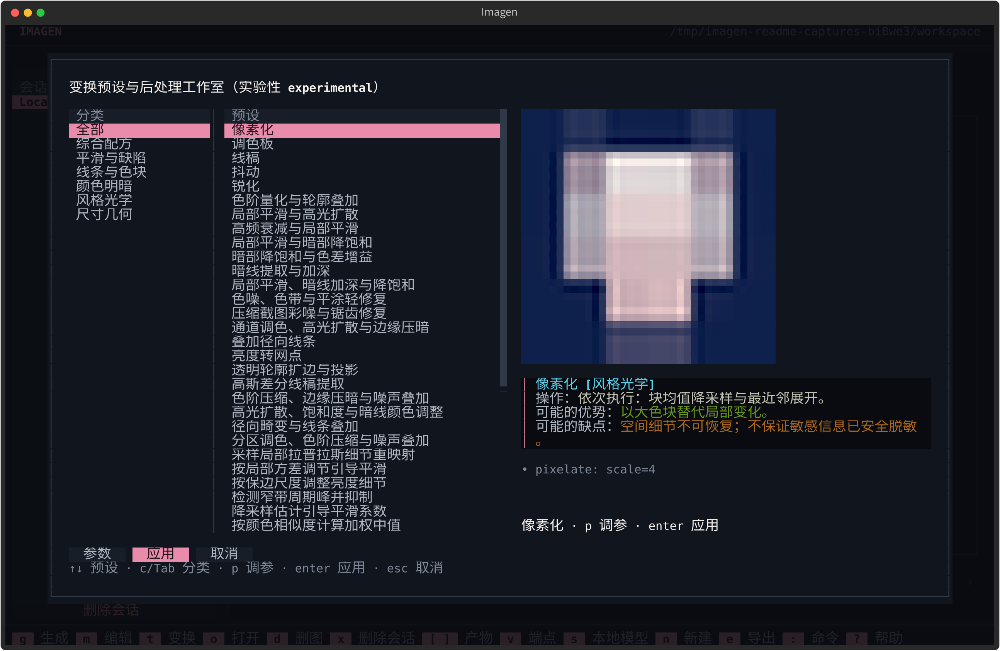</p>

<p align="center">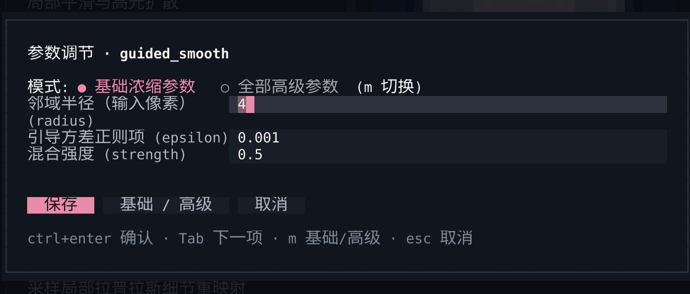</p>

参数截图为 `guided_smooth` 编辑弹窗的裁剪。浏览预设并实时预览，调整参数后应用。结果另存为新产物。

```bash
imagen ops                                  # 目录
imagen ops --op guided_smooth               # 单个算子
imagen ops --preset '去AI塑料感' --verbose    # 配方详情
imagen transform ARTIFACT_ID --preset '像素化'
imagen transform ARTIFACT_ID --op 'guided_smooth:radius=4,epsilon=0.001,strength=0.5'
imagen compare --first art_a --second art_b
imagen sheet --artifacts art_a,art_b,art_c --columns 3
```

目录覆盖平滑、线条提取、明暗与颜色调整、周期频率抑制、缩放、联系表和图像比较。部分操作参考引导滤波、加权最小二乘和 Local Laplacian 方法，近似实现与变体会注明。

各项变换可能改变：

- 平滑可能损伤细线。
- 锐化可能增加噪声。
- 频率抑制可能删除有意的网点。
- 差异指标只给出数值，结论请打开图片对照。

`元数据提纯`（`--preset '元数据提纯'` 或 `--op strip_metadata`）先应用 EXIF 方向，再重新编码，丢弃 EXIF、XMP、IPTC、C2PA 与 PNG 文本块；ICC 色彩配置保留。PNG 到 PNG 像素不变。它不处理 SynthID 这类像素级不可见水印。结果另存为新产物，源文件不变。

TUI：`t` 打开普通图像处理页，`p` 调参，`enter` 应用。`u` 打开模型工作台，直接选择真实模型，按 ACG／修复筛选，查看原图和预计输出尺寸，调节后端、分块、重叠与超时。支持前台／后台执行，下载权重和每次运行确认分开操作。`s` 管理本地权重与运行时。应用会生成新产物，源文件保持不变。

### 阻塞、后台任务与进度

`transform` 和 `superres run` 默认等待处理结束，`--wait` 显式选择相同行为。使用 `--async` 前先启动 worker；命令返回任务 ID 后，处理继续在后台运行。

```bash
imagen transform ARTIFACT_ID --op 'resize:scale=2' --wait
imagen worker start
imagen transform ARTIFACT_ID --op 'invert' --async
imagen superres run ARTIFACT_ID --model realesrgan-x4plus --accept --async
imagen job get JOB_ID
imagen job wait JOB_ID --timeout 900
imagen job cancel JOB_ID --scope local
```

启动 worker 也会执行已经排队的生成请求，请先检查队列。本地任务记录输入、目标会话、参数和结果；`session show` 同时列出生成与本地处理产物，包括历史处理结果。

CLI 在交互终端的 stderr 显示进度条。JSON 只返回最终结果，JSONL 包含进度事件。TUI 显示相同处理阶段：普通管线计数已完成步骤，模型推理计数已完成分块，加载、编码和保存显示活动指示。远程生成显示可观察的阶段。后台处理完成后，TUI 自动载入新产物。

本地处理有两个可调上限。处理超时按图片尺寸和所选算子自适应；用 `IMAGEN_POSTPROCESS_TIMEOUT`（秒，`0` 表示不限制）或在 `config.json` 写入 `"postprocess_timeout_seconds"` 覆盖它，单次运行可用 `--timeout 0` 取消防线。工作内存默认 2 GiB；用 `IMAGEN_POSTPROCESS_MEMORY_MB`（MiB，`0` 表示取消上限和确认提示）或在同一文件写入 `"postprocess_memory_mb"` 调整，该文件位于 `imagen-cli` 的平台用户配置目录。超过上限时会先请求确认，而不是静默失败。

处理超时会停止本次计算；`job wait` 超时只停止等待，任务继续运行。本地取消可以停止排队或执行中的处理，不保存半成品图片。

超过默认像素或工作缓冲预算时，Imagen 显示尺寸和内存风险，询问是否继续，默认取消。非交互 CLI 返回 `approval_required`；用户明确接受风险后，用响应中的摘要加 `--budget-approval DIGEST` 重跑同一请求。确认绑定原图内容与处理参数，修改任一项都需要重新确认。内存不足或超时仍会让请求失败。

## 可选超分

<details>
<summary>独立模型处理页与本地模型管理页</summary>

<p align="center">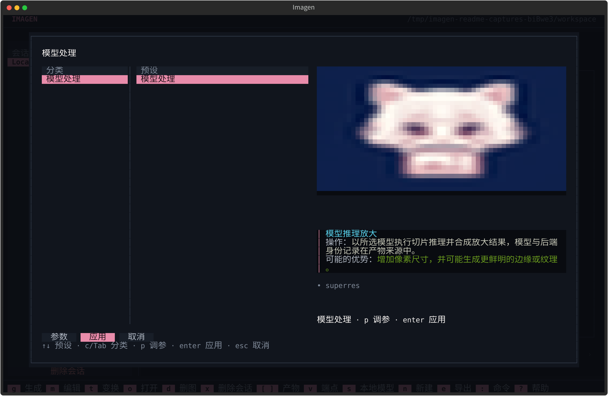</p>

`u` 打开模型处理。图中预览使用本地示例图。

<p align="center">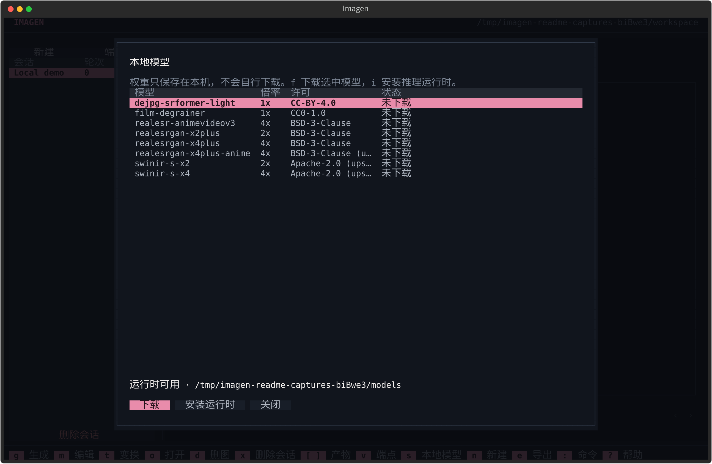</p>

`s` 打开本地模型管理。截图过程中没有下载权重或运行模型。表内部分许可说明被截断，完整信息以 `imagen superres models` 和来源许可说明为准。

</details>

查看本地模型与许可，不下载权重：

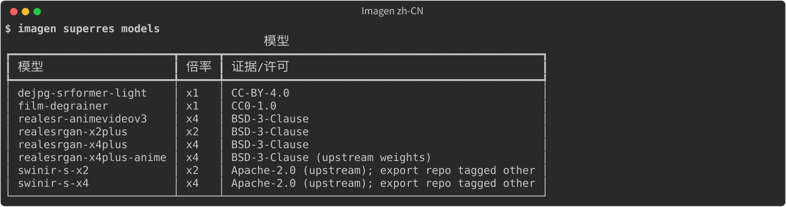

```bash
imagen superres models
```

选定模型并查阅来源与权重许可后：

```bash
imagen superres fetch --model realesrgan-x4plus --accept
imagen superres benchmark --artifact ARTIFACT_ID --model realesrgan-x4plus
```

显式安装可选推理依赖并下载所选权重（未加 `--accept` 仅预览）：

```bash
imagen superres install --model realesr-animevideov3
imagen superres install --model realesr-animevideov3 --accept
```

也可以只安装运行时，不给 `--model` 即可（第一条仅预览）：

```bash
imagen superres install --backend cpu
imagen superres install --backend cpu --accept
```

命令只安装到当前 ImagenCli 所在虚拟环境，拒绝修改系统 Python。
CUDA 或 OpenVINO 需显式选择 `cuda` 或 `openvino`；检测到其他 ONNX 后端包时拒绝安装，
不会擅自卸载或切换后端，也不安装显卡驱动。安装后请重启 ImagenCli。
源码环境后续执行 `uv run` / `uv sync` 时仍需保留 `--extra ai-onnx`（或所选后端 extra）。
TUI 命令面板提供同样的后端与确认选项。

超分、原尺寸降噪与 JPEG 伪影清理使用独立模型处理命令：

```bash
imagen superres run ARTIFACT_ID --model realesrgan-x4plus
imagen superres fetch --model film-degrainer --accept
imagen superres run ARTIFACT_ID --model film-degrainer
imagen superres fetch --model dejpg-srformer-light --accept
imagen superres run ARTIFACT_ID --model dejpg-srformer-light
```

旧 `transform --op superres:...` 脚本保持兼容。独立入口复用同一套执行、预算确认与产物保存链路。

Film-Degrainer（tika）标记为 CC0-1.0；DeJPG_SRFormer_light（Helaman）为 CC BY 4.0，
要求保留署名并说明变更。两者均为 notaneimu 的社区 ONNX 转换，不是官方导出。
`imagen superres models` 显示来源与许可说明；这两种模型不放大图片，也不保证提升画质。

动漫与赛璐璐内容有两种放大模型可选：

```bash
imagen superres install --model realesrgan-x4plus-anime --accept
imagen superres install --model realesr-animevideov3 --accept
```

两者均为 BSD-3-Clause。`realesr-animevideov3` 面向赛璐璐动画帧与平涂色块，
其固定 ONNX 导出记录了上游摘要与参考张量。确定性的 ACG 清理不需要下载模型：

```bash
imagen transform ARTIFACT_ID --preset "ACG 赛璐璐轻修复 (ACG Cel Cleanup)"
imagen transform ARTIFACT_ID --op 'chroma_denoise:radius=2,strength=0.8'
imagen transform ARTIFACT_ID --op 'edge_antialias:radius=1,strength=0.6'
imagen transform ARTIFACT_ID --op 'cel_banding_reduce:strength=0.4'
```

下载会先进入临时目录，按固定 SHA-256 摘要校验，再发布到权重目录。失败或摘要不符不会留下可用权重。

超分运行时和权重只在你执行安装命令并接受许可后安装。源码许可与权重许可分别授予，下载前请阅读权重许可。模型重建纹理时会生成新的细节，这些细节可能与原图不同。

## Agent skills

随包 skills 教 agent 何时使用 Imagen、如何发现命令与 schema、如何遵守计划与批准流程、如何处理 unknown outcome，以及如何守住费用、凭据和权重下载边界。

```bash
imagen skills list
imagen skills install                     # 在终端里询问装到哪些 agent
imagen skills install --target universal  # 共享的 .agents/skills 目录
imagen skills install --target claude-code --target codex
imagen skills install --scope global --target claude-code
imagen skills uninstall --target codex
```

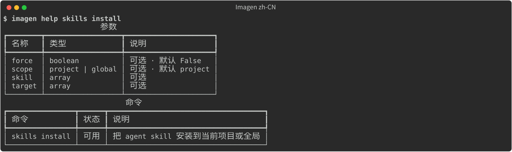

- 默认安装到当前项目；`--scope global` 安装到用户目录。
- 未指定 `--target` 时安装到 `universal`，即多数 agent 都会读取的共享目录 `.agents/skills`。需要更多 agent 时重复传 `--target`；`--target all` 选择兼容表中的全部目标。
- 在终端中未指定 `--target` 时打开勾选列表：方向键移动、空格选择、`a` 全选、回车确认、`q` 取消。共享目录和项目里已存在的 agent 目录默认勾选。没有终端（或加 `--no-interactive`）时直接装到默认目标，不提问。
- 全局安装时会报告仅支持项目作用域的目标。
- 安装会写入托管清单（`.imagen-install.json`）。卸载不会删除未托管目录或符号链接路径；已修改的受管 skill 需要 `--force --yes`。

随包 skills 为 `imagen`、`imagen-assets` 和 `imagen-batch`。

## 机器接口

`--agent` 返回单个 JSON envelope；`--output json` 相同；`--output jsonl` 输出事件流。

```json
{
  "schema_version": 1,
  "ok": false,
  "status": "approval_required",
  "data": {},
  "error": {
    "type": "approval_required",
    "message": "...",
    "retryable": false,
    "accepted_maybe": false,
    "next_actions": []
  }
}
```

中英文下 JSON 键、状态名和标识完全一致，只有人类可读的消息文本跟随界面语言。

退出码：

| 码 | 含义 |
| --- | --- |
| 0 | succeeded、accepted、approved 或 planned |
| 2 | 参数错误或不支持的能力 |
| 3 | 认证或权限错误 |
| 4 | 未找到 |
| 5 | 冲突 |
| 6 | 等待超时、结果未知或需要批准 |
| 7 | 失败、保存失败或取消 |
| 8 | 内容安全拒绝 |
| 9 | 部分成功 |

`imagen schema COMMAND` 返回输入、数据与事件 schema；`imagen --agent help` 返回命令索引与调用规则。

## 数据与隐私

会话、计划、任务、受管图片、缓存和私有凭据都保存在工作区中，默认位于用户数据目录。使用 `--workspace PATH` 可以切换工作区。

- 生成与编辑会把提示词和必要输入发送到配置的端点，适用该端点的保留、日志和计费政策。
- 会话导出不包含私有凭据。
- 供应商错误只保留安全分类；原始响应内容不会出现在人类输出中。
- 结果未知的创建等你核对任务，Imagen 不会自动重试。
- 后处理写入新产物，源文件保持不变。
- 模型权重只在你接受许可后下载。
- 提权只在交互确认之后发起。

## 语言

帮助、人类可读输出、错误和 TUI 默认使用英文。

```bash
imagen --zh help                  # 单次命令使用中文
imagen --en help                  # 强制英文
export IMAGEN_LANG=zh-CN          # 仅当前 shell
imagen language zh-CN             # 保存为默认
imagen language                   # 查看已保存的默认
imagen tui
```

`--zh` 和 `--en` 是快捷参数，`--lang en|zh-CN` 是显式写法。语言参数优先于 `IMAGEN_LANG`，同一条命令只能使用一个语言选项。

`imagen language [en|zh-CN]` 会把默认语言写入平台配置目录（Imagen 用户配置路径下的 `config.json`，仅本人可读）。TUI 内按 `l` 同样会保存，重启后保持。优先级依次为：命令行参数、`IMAGEN_LANG`、已保存的默认值、英文。

## 常见问题

**`approval_required`。** 生成请求先审阅计划，再带摘要执行 `plan approve` 与 `plan execute`。本地大图处理则先审阅预算报告，再加 `--budget-approval DIGEST` 重跑同一请求；预算摘要对应一次独立的确认，与生成计划批准分开。

**结果为 `unknown`。** 不要重跑请求。先用 `job get` 核对；如果已有持久响应，使用 `job fetch` 或 `job reconcile`。

**模型不存在。** 运行 `models refresh --profile NAME`，或用 `models add --profile NAME --id MODEL` 手动声明。

**端点拒绝编辑或某个参数。** 能力取决于供应商和模型。检查 `providers`、模型目录和端点文档。

**TUI 预览不可用。** 图片预览需要 truecolor 终端；产物仍可用 `o` 或 `imagen asset open` 打开。

**skill 无法卸载。** 目录未托管、是符号链接，或安装后被本地修改。先检查报出的路径；已修改的受管 skill 需要 `--force --yes`，未托管目录不会被接管。

**超分在推理前失败。** 缺少运行依赖或权重。运行时用 `superres install --backend cpu --accept` 安装；权重先运行 `superres models`，审阅许可后执行 `superres fetch --model NAME --accept`。

**命令返回 `permission_denied`。** 重试前先检查文件权限与所需的平台权限。在支持的平台上，交互式终端可以询问是否提权重跑同一命令，默认否。机器输出模式、`--no-interactive` 和 TUI 不会发起 UAC；agent 必须先询问人类，再执行任何提权操作。

## 后续发展

- **端点执行**：在现有本地队列与 worker 之外，补齐远程异步任务处理。
- **图像质量**：扩展插画、摄影等领域的视觉对照与用户偏好评价；完成前，后处理保持 experimental。
- **平台支持**：补充 Windows 实机验证，改进 Windows/macOS 处理资源控制。尺寸、缓冲和超时检查尚未达到完整沙箱的程度；Linux 地址空间限制只管虚拟地址空间，RSS 和显存仍可继续增长。
- **语言支持**：增加更多界面语言。默认英文，中文可通过 `--lang zh-CN` 或 `IMAGEN_LANG=zh-CN` 使用。
- **界面一致性**：完善批量、worker 和 skills 的独立 TUI 工作流；命令面板与本地模型管理已可用。

## 开发

```bash
uv sync --group dev --extra tui --extra postprocess
uv run pytest
uv run ruff check .
uv run mypy src
```

默认测试离线运行。live 供应商测试标记为 `live`，需要显式授权和凭据，不属于日常开发流程。

源码结构：

| 路径 | 职责 |
| --- | --- |
| `src/imagen_cli/cli` | 入口、命令注册、渲染器、TUI |
| `src/imagen_cli/application` | 规划、执行、产物、会话、后处理、skills |
| `src/imagen_cli/domain` | 契约、标识、错误 |
| `src/imagen_cli/providers` | 端点适配器 |
| `src/imagen_cli/execution` | 队列、worker、已配置执行 |
| `src/imagen_cli/storage` | SQLite、产物、私有状态、工作区安全 |

## 参与贡献

使用问题或可复现的错误请[提交 issue](https://github.com/NekoCCN/ImagenCli/issues)，附上 Imagen 版本、操作系统、命令和脱敏后的错误。不要附带 API key、供应商原始响应或私有工作区导出。已发布的变更见 [Releases](https://github.com/NekoCCN/ImagenCli/releases)。

欢迎范围明确的修改。行为变化请补充测试，保留端点请求的计划与批准边界；未经明确授权，不新增 live 或付费端点测试。

## 许可证

Imagen 源码采用 [MIT License](LICENSE)。第三方依赖、端点服务和模型权重适用各自的许可与条款。

